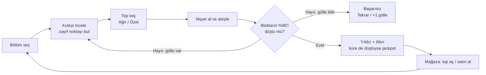
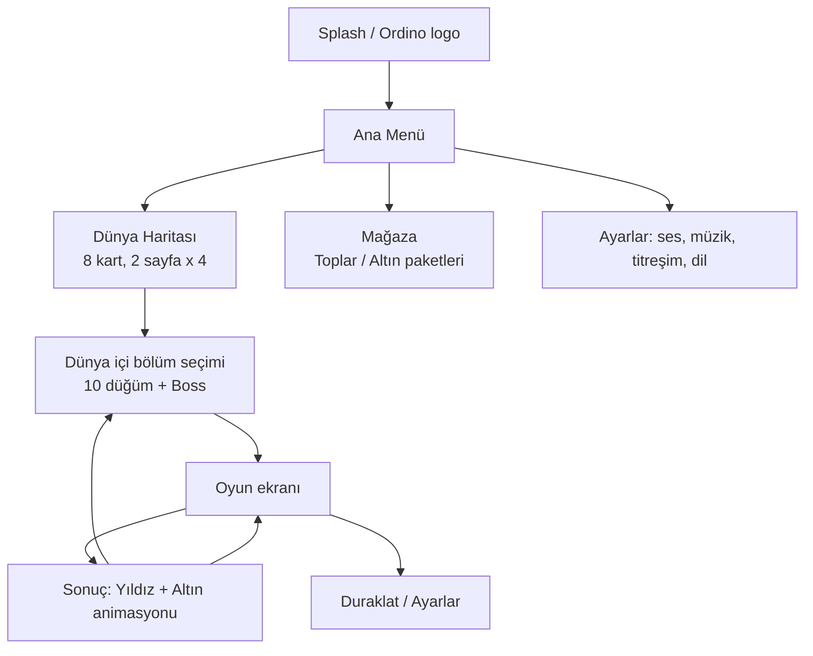

# 01 — Oyun Tasarım Dokümanı (GDD)

> Sürüm 0.1 · Sahip: Sena · Durum: taslak. `⚙️` işaretli her değer `game_data/` içinden değiştirilebilir.
> `💡 Claude önerisi` ile işaretli kısımlar öneridir; Sena onaylayana kadar kesin değildir.

---

## 1. Vizyon
**"Physics. Impact. Satisfaction."** — Tek parmakla nişan al, at, kulenin muhteşem şekilde çöküşünü izle.
Rakiplerden farkımız:
1. **Görsel kalite:** Her dünya sinematik, ışıklı, canlı bir sahne (bkz. `referans/`). Bloklar parlak, kristaller ışık saçar.
2. **Tatmin hissi (juice):** Her çarpışma ses + parçacık + titreşim; son blok düşerken ağır çekim.
3. **Özel toplar:** Her top fiziği farklı şekilde büker (yakar, keser, dondurur, elektrik yayar, çeker).
4. **Akıllı kule tasarımı:** Her kulede "zayıf nokta" vardır; zeki atış 1 güllede kuleyi yıkar → 3 yıldız.

Hedef kitle: 8–60 yaş, casual/hyper-casual + puzzle oyuncuları. Oturum: 2–5 dk. Bölüm: 20–60 sn.

---

## 2. Çekirdek döngü (core loop)



**Meta döngü:** Yıldız topla → dünyaların kilidini aç → yeni toplar açılır → toplar altınla yenilenir → zor bölümleri geç.

---

## 3. Oynanış kuralları

### 3.1 Ekran düzeni (portre, bkz. referans görseller)
- Üst sol: `LEVEL 24` etiketi · Üst orta: **kalan gülle göstergesi** (●●●) · Üst sağ: ayarlar ⚙.
- Orta: kule + platform, arka planda dünya sahnesi.
- Alt orta: **top (cannon)**, önünde nişan çizgisi (beyaz noktalı yörünge).
- Alt şerit (yeni): **top seçici** — Ağır Top (sınırsız) + sahip olunan özel topların ikonları ve adetleri.

### 3.2 Nişan ve atış
- Oyuncu ekrana dokunup sürükler → top o yöne döner, yörünge önizlemesi çizilir.
- Parmağı bırakınca atış. ⚙️ `rules.aim.mode`: `"tap_target"` (**varsayılan**; dokunulan noktaya atış, Smash Away tarzı) | `"drag_release"`.
  `drag_release` (sapan): ekranın herhangi bir yerine bas, geri çek, bırak. Aşağı çekmek namluyu yükseltir, sola çekmek sağa atar;
  açı = çekme × `rules.aim.drag_deg_per_px`, hız sabit (topun `launch_speed`'i), `drag_dead_zone_px`'ten kısa çekişte atış yok.
- ✅ Karar (S-002, Sena onayladı): Varsayılan **tap_target** + ince ayar için sürükleme. Tam 3D'de dokunulan noktadan ışın (raycast) atılır, isabet eden blok yüzeyi hedef olur. Smash Away'in başarısı kontrolün çok basit olması; bu "noktayı seç, at" hissini koruyalım.
- Yörünge önizleme uzunluğu ⚙️ `rules.aim.preview_dots` (zor bölümlerde kısalabilir — zorluk parametresi).
- Top fiziksel bir mermidir: kütle, hız, yerçekimi etkisi `balls.json` içinde.

### 3.3 Kazanma koşulu (bölüm bazında seçilir) ⚙️ `level.objective.type`
✅ Karar (K-018, Sena onayladı — K-010'un yerine): **Ana hedef "masayı temizle", Altın Küre jackpot.**
✅ **K-030 (2026-11-19):** Altın Küre **hiçbir zaman bölümü bitirmez** — her bölümde kazanma koşulu temizliktir, küre her zaman yalnızca jackpot altını verir. `drop_core` / `drop_all_cores` kaldırıldı.

| Tip | Açıklama | Ne zaman kullanılır |
|---|---|---|
| `clear_percent` | Blokların **%80'i** (⚙️ `rules.objective_defaults.clear_percent_target`) platformdan düşerse kazanırsın. Oran **blok hacmine** göre (⚙️ `clear_measure = "volume"`, alternatif `"count"`); Altın Küre ve joint'ler (halat/zincir/sarmaşık) orana dahil değil; **kırılan bloklar temizlenmiş sayılır** (⚙️ `broken_counts_as_cleared`). Ekranda **doluluk çubuğu**. Otomatik final temizliği **yok** | **Varsayılan** (Smash Away tarzı) |
| `shatter_crystals` | Tüm kristal blokları (turuncu/turkuaz) kır | Kristal ağırlıklı özel bölümler |

**Sürekli atış:** gülle bir yere çarptıktan ⚙️ `rules.shots.refire_cooldown_sec` (0.3 sn) sonra yeni atış yapılabilir; kulenin durulması beklenmez.
Kazanma her an kontrol edilir: hedefe (%80) ulaşıldığı an kazanılır. Kaybetme yalnızca son gülle atılıp fizik **durulunca** (veya ⚙️ `rules.physics.settle_timeout_sec`) değerlendirilir.
Yıldızlar kullanılan gülle sayısına göre.

**Altın Küre jackpot (K-018):** `clear_percent` bölümlerinde küre kulenin içine, kemer altına veya tepeye **gömülü** durur.
Bölüm sırasında düşerse: ağır çekim + konfeti + büyük altın ödülü (⚙️ `economy.rewards.core_jackpot_gold`). **Yıldızı etkilemez.**
Zorluk arttıkça küre daha derine gömülür (`docs/03` §4 kural 6).

### 3.4 Gülle hakkı
- Her bölümün gülle hakkı vardır ⚙️ `level.shots` (genelde 3; zorlukla değişir).
- Özel top kullanmak bir gülle hakkını harcar (yani özel top ekstra hak değil, **daha güçlü bir hak**).
- Gülle bitince: "Başarısız" ekranı → **Tekrar dene** (ücretsiz) veya **+1 Gülle** (⚙️ altın fiyatı veya ödüllü reklam).

### 3.5 Yıldız sistemi ⚙️ `rules.stars`
💡 Claude önerisi (varsayılan, değiştirilebilir):
| Yıldız | Koşul (`stars.mode = "shots_left"`) |
|---|---|
| ⭐⭐⭐ | Kalan gülle ≥ `shots - 1` (yani 3 haklık bölümü 1 atışta bitir) |
| ⭐⭐ | Kalan gülle ≥ `shots - 2` |
| ⭐ | Bölüm geçildi |

Alternatif mod `stars.mode = "score"`: skor = yıkım puanı + kalan gülle bonusu; eşikler bölüm JSON'unda. Önce basit mod.
Özel top kullanımı yıldızı **düşürmez** (oyuncuyu özel top kullanmaya teşvik ederiz → altın harcaması).

Level map'teki "24/30" = dünyadaki 10 bölüm × 3 yıldız. Dünya kilidi ⚙️ `worlds[i].unlock_stars_required`.

---

## 4. Dünyalar (8 adet, sırayla)

Her dünyanın: **arka planı**, **imza malzemesi**, **çevresel kuralı (modifier)** ve **müzik/ambiyans** paketi olur.
Modifier'lar dünyalar arasında oyun hissini değiştirir — sadece "deri değişimi" olmasın diye. Hepsi ⚙️ `worlds.json`.

| # | Dünya | İmza malzemeler | 💡 Çevresel kural (modifier) | Tanıtılan top |
|---|---|---|---|---|
| 1 | **Akdeniz Sahili** | Kireçtaşı kemer, ahşap, kristal | Yok (öğretici dünya) | Ağır Top (başlangıç), Alev Topu (B7 geçilince açılır, B8 tanıtım bölümü) |
| 2 | **Korsan Gemisi** | Ahşap, sandık, halat, fıçı | **Sallanan güverte:** platform hafifçe yalpalar (`platform_sway`) | Kesici Çark (B5) |
| 3 | **Yanardağ** | Lav taşı (çatlak), obsidyen, zincir | **Lav zemini:** düşen blok anında erir (yıkım bonusu), sıcak bloklar Buz ile çatlar | Buz Topu (B5) |
| 4 | **Buz Mağarası** | Buz blok, karlı taş, buz sarkıtı | **Kaygan:** düşük sürtünme (`friction_mult 0.4`) | — (pekiştirme) |
| 5 | **Çöl Vadisi** | Kumtaşı, altın süslemeli taş, sandık | **Kum fırtınası:** yatay rüzgâr topu saptırır (`wind`) | Elektrik Topu (B5) |
| 6 | **Büyülü Orman** | Yosunlu taş, sarmaşık (bağlantı), mor kristal | **Sarmaşık bağları:** bloklar birbirine joint ile bağlı; Kesici/Alev koparır | — |
| 7 | **Gökyüzü Adaları** | Kemerli taş köprü, bulut taşı, mavi kristal | **Düşük yerçekimi** (`gravity_mult 0.7`) + platformlar arası boşluk | Çekim Topu (B3) |
| 8 | **Sualtı Harabeleri** | Mercan taş, antik sütun, deniz kristali | **Su direnci:** top ve parçalar yavaş (`linear_damp`), kaldırma kuvveti | — (final dünya) |

Her dünya içi kart (level map) → dünyaya girince **dünyaya özel bölüm seçim ekranı**: arka planda dünyanın sahnesi,
10 bölüm düğümü (yol/patika üzerinde), her düğümde yıldızlar. Bölüm 10 = **Boss** (büyük ikonlu).

---

## 5. Toplar (gülleler) ⚙️ `balls.json`

Görseldeki "Özel Top Seti" ile birebir. Her topun: fiziksel özellikleri + **davranış (behavior)** + **malzeme etkileşim çarpanları**.

| Top | Görseldeki açıklama | Oyun mekaniği (uygulama) | Güçlü olduğu | Zayıf olduğu |
|---|---|---|---|---|
| **Ağır Top** | Yüksek kütlesiyle blokları ezer, kırar, yıkar | Standart fiziksel top. Sınırsız. | Taş, genel | — |
| **Alev Topu** | Ahşap blokları tutuşturur, yakar, ortadan kaldırır | Çarptığı yanıcı (`flammable`) bloğu tutuşturur; ateş komşu yanıcılara yayılır (`spread_radius`, `spread_chance`); yanan blok `burn_time` sonra kül olur | Ahşap, sandık, halat, sarmaşık | Taş, buz (söner) |
| **Kesici Çark** | Ahşap, ip ve benzeri yapıları keserek parçalar | Delip geçer (`pierce_count`): kesilebilir (`cuttable`) blokları ikiye böler, halat/zincir joint'lerini koparır, yavaşlayarak ilerler | Ahşap, halat, sarmaşık | Taş, metal (seker) |
| **Buz Topu** | Yapıları dondurur, kırılgan hale getirir, darbe ile parçalanmayı kolaylaştırır | Çarpma noktası çevresindeki (`freeze_radius`) blokları dondurur: `hp × brittle_mult`, sürtünme düşer; dondurulmuş blok sonraki darbede kristal gibi parçalanır | Sonraki atışı hazırlar; Yanardağ lav taşı (termal şok ×2) | Tek başına zayıf |
| **Elektrik Topu** | Temas ettiği bloklara elektrik yayar, çevresindeki yapıları etkileyip zayıflatır | Zincirleme şimşek: iletken (`conductive`) ve temas eden bloklar arasında `chain_count` atlama, her atlamada hasar + küçük itme | Metal, kristal, ıslak (sualtı) | Ahşap (yalıtkan) |
| **Çekim Topu** | Çevresindeki nesneleri kendine çeker, birleştirir ve büyük bir yıkım oluşturur | Çarpınca `pull_duration` süre kara delik: `pull_radius` içindeki bloklara merkeze kuvvet; sonunda `implode_impulse` ile dışa patlama | Dağınık, geniş kuleler; çift kule | Tek dar kule (gereksiz) |

### 5.1 Top açılma ve sahiplik (TAMAMEN AYARLANABİLİR) ⚙️ `balls.json → unlock` + `economy.json`
Her top için:
```json
"unlock": { "type": "level_cleared", "level_id": "w01_l07" },   // veya "levels_cleared_count": 12, "world_completed": 2, "stars_total": 40
"tutorial_level_id": "w01_l07",                                 // top bu bölümde tanıtılır, bölüm o topla çözülecek şekilde tasarlanır
"gift_on_unlock": 3,                                            // açılınca hediye adet
"price_gold": 150, "pack_size": 3                               // sonra: 150 altına 3 adet
```
💡 Claude önerisi (başlangıç değerleri `balls.json`'da hazır):
| Top | Açılma | Hediye | Paket fiyatı |
|---|---|---|---|
| Ağır | Baştan | ∞ | — |
| Alev | Dünya 1 Bölüm 7 geçilince | 3 | 120 altın / 3 adet |
| Kesici Çark | Dünya 2 Bölüm 5 | 3 | 150 / 3 |
| Buz | Dünya 3 Bölüm 5 | 3 | 180 / 3 |
| Elektrik | Dünya 5 Bölüm 5 | 3 | 220 / 3 |
| Çekim | Dünya 7 Bölüm 3 | 2 | 300 / 2 |

**Tanıtım bölümü kuralı:** Topun açıldığı bölümün **hemen sonraki bölümü** o topun en iyi çözüm olduğu şekilde tasarlanır
ve o bölümde top ücretsiz +1 verilir (oyuncu "vay!" desin). Tasarım: `docs/03` §7.

### 5.2 Top yükseltmeleri (v2 — şimdilik kapalı) ⚙️ `rules.features.ball_upgrades = false`
Altınla seviye: Alev yayılma +%, Elektrik zincir +1… Altın harcama derinliği için ileride.

---

## 6. Malzemeler (bloklar) ⚙️ `materials.json`
Her blok = **şekil (shape)** + **malzeme (material)**. Malzeme fizik ve etkileşimi belirler.

| Malzeme | Görünüm | Yoğunluk | Dayanıklılık | Bayraklar |
|---|---|---|---|---|
| `stone` kireçtaşı | Krem, kemer/blok | Yüksek | Yüksek | — |
| `wood` | Kahverengi kalas, vidalı | Orta | Orta | flammable, cuttable |
| `crate` sandık | X çaprazlı kutu | Düşük | Düşük | flammable, cuttable |
| `crystal_amber` | Turuncu parlak cam | Orta | **Kırılgan** | conductive, shatter, bonus altın |
| `crystal_cyan` | Turkuaz parlak cam | Orta | **Kırılgan** | conductive, shatter, bonus altın |
| `ice` | Saydam mavi | Orta | Orta, kaygan | freezable(zaten), meltable |
| `lava_rock` | Koyu, turuncu çatlaklı | Yüksek | Yüksek | thermal_shock (Buz ×2) |
| `metal` | Perçin, plaka | Çok yüksek | Çok yüksek | conductive |
| `rope` / `chain` / `vine` | Bağlantı (joint) | — | Düşük/Yüksek/Orta | joint; rope/vine cuttable+flammable |
| `core_gold` | **Altın Küre** (yalnızca jackpot, K-030) | Orta | Kırılmaz | objective |

**Kristal bloklar** (turuncu/turkuaz) kırılınca küçük altın (⚙️ `materials.json → coin_on_break`) ve tatmin edici cam kırılma efekti verir → oyuncuyu "daha çok yık" yönünde ödüllendirir.

---

## 7. Ekranlar ve akış


- **Dünya Haritası:** referans `05_level_map_8_dunya.png` → portrede 2 sütun × 4 satır kaydırmalı liste; üstte toplam yıldız, altın, (ileride elmas).
- **Sonuç ekranı:** yıldızlar tek tek "çarparak" gelir, altınlar HUD'daki sayaca uçar, sayı yuvarlanarak artar.
- **Mağaza:** sekmeler: *Toplar* (her top kartı: görsel, açıklama, adet, "150 🪙 / 3 adet") · *Altın* (IAP paketleri) · (ileride) *Reklamsız*.

---

## 8. İlk kullanıcı deneyimi (FTUE)
1. Bölüm 1: el animasyonu "dokun ve at" — dar platform, kırılgan kule; 1 gülle bile yeter → **doluluk çubuğu** dolar, ilk 10 saniyede zafer.
   Kulenin içine gömülü Altın Küre büyük ihtimalle birlikte düşer → ilk **jackpot** kutlaması ("Altın Küre! +N altın").
2. Bölüm 2: "Kemerin altındaki desteğe vur" ipucu (zayıf nokta = en büyük çöküşü başlatan blok). Küre bu kez daha korunaklı:
   jackpot kaçarsa "tekrar dene" motivasyonu (yıldız zaten alınmış olabilir).
3. Bölüm 3: ilk kez 2 atış gerekiyor → gülle göstergesi tanıtımı.
4. Bölüm 5: ilk yıldız ödülü sonrası mağaza tanıtımı (ama satın alma baskısı yok).
5. Bölüm 7 sonrası: **Alev Topu açıldı!** sinematik + 3 hediye + Bölüm 8 alev için tasarlanmış.

---

## 9. Açık tasarım soruları (Sena karar verecek → `08_KARAR_GUNLUGU.md`)
- İkinci para birimi (Elmas) olacak mı? Referans level map'te 💎 var. Öneri: v1'de **sadece altın**, sistem çoklu para birimine hazır.
- Can/enerji sistemi olacak mı? Öneri: **Hayır** (casual oyuncuyu kaçırır); gelir = altın paketleri + opsiyonel ödüllü reklam.
- Reklam (interstitial) olacak mı? Öneri: v1'de yalnızca **ödüllü reklam** (oyuncu isteyerek izler), + "Reklamları kaldır" paketi.
- Bölüm sayısı: şimdilik 80 (8×10). Sistem dünya başına bölüm sayısını JSON'dan okur.
