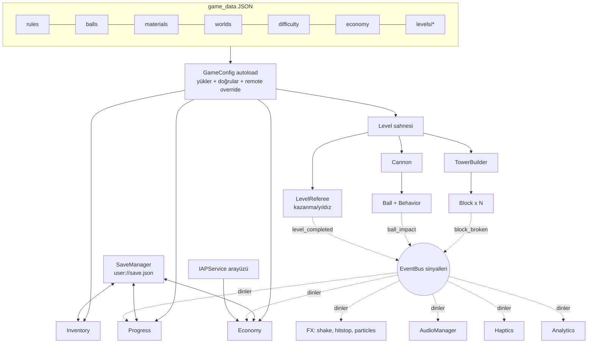

# 02 — Teknik Mimari

> Kod yazmadan önce bu dosyayı oku. Buradaki yapıdan sapmak gerekiyorsa önce gerekçeyle Sena'ya öner, onaylanırsa bu dosyayı güncelle.

---

## 1. Motor kararı: Godot 4.7 (Unity değil) — gerekçe

| Kriter | Godot 4.7 | Unity 6 |
|---|---|---|
| Claude Code ile çalışma | ✅ Sahneler (`.tscn`), kaynaklar (`.tres`), kod (`.gd`) **düz metin** → Claude doğrudan okuyup yazabilir | ⚠️ Sahne/prefab YAML'ları büyük ve kırılgan; çoğu iş editörde elle |
| Lisans / ücret | ✅ MIT, tamamen ücretsiz, gelir payı yok | Ücretsiz katman var ama gelir eşikleri/koşullar şirket politikasına bağlı |
| 3D fizik | ✅ Jolt (4.6'dan beri varsayılan 3D fizik) | ✅ PhysX, olgun |
| Mobil IAP / reklam | ⚠️ Topluluk + resmi eklentiler (Google Play Billing, iOS StoreKit eklentileri) — 4.5.2/4.6 ile mobil ekosistem ciddi iyileşti | ✅ Çok olgun (Unity IAP, LevelPlay) |
| Proje boyutu / hız | ✅ Editör ~150 MB, açılış saniyeler | ⚠️ Ağır |
| Görsel tavan | Bu oyun için yeterli (glow, PBR, parçacık, shader) | Daha yüksek ama gerek yok |

**Sonuç:** Bu oyun küçük-orta ölçekli, fizik + görsel efekt ağırlıklı ve **Claude ile metin tabanlı geliştirileceği için Godot** daha verimli.
Tek risk IAP/reklam eklentileri → `IAPService` / `AdsService` arayüzleriyle soyutlanır; eklenti değişse oyun kodu değişmez.

- Sürüm: **Godot 4.7.x stable** (4.8 beta çıkmış olsa da stable'da kal; Faz 10'dan önce güncellemeyi değerlendir).
- Dil: **GDScript, statik tipli.** C# kullanma (iOS dışa aktarımında ek risk ve karmaşıklık).

---

## 2. 2D mi 3D mi? → **Tam 3D** (K-002, Smash Away tarzı)

**Karar (K-002 — değişti):** Sena tam 3D görünümü istiyor. Önceki öneri (XY düzlemine kilitli 2.5D) kaldırıldı.
- Bloklar ve toplar gerçek **3D model + 3D fizik**; **hiçbir eksen kilidi yok** (`axis_lock_*` hepsi `false`, Godot varsayılanı).
- Bloklar her eksende serbestçe döner, devrilir, platformdan **her yöne** (sağa, sola, öne, arkaya) düşer.
- Kuleler **derinlikli** kurulur: x (sağ–sol), y (yukarı), z (ön–arka). Koordinatlar ve bölüm formatı: `03` §2.
- Arka yüzler de görünebilir → bloklar **6 yüzü de dokulu** modellenir (Blender scripti buna göre).

**Kamera** ⚙️ `rules.camera`:
- **Perspektif**, FOV ≈ 40°, kuleye **yukarıdan ≈ 20° eğik** (pitch) bakar, kule odağına uzaklık ≈ 16 birim.
  Kulenin ön, üst ve kısmen yan yüzleri görünür → derinlik ve hacim okunur (referans görsellerdeki premium 3D his).
- **v1'de kamera sabit** (S-007, Önerildi): çapraz, ≈20° yukarıdan. Kule etrafında döndürme (orbit) **v2'de** değerlendirilir → `rules.camera.orbit_enabled = false`.
- Bölüm bazında `camera_override` (yaw/pitch/distance) ile geniş veya ikiz kulelerde kadraj ayarlanabilir.

**Okunabilirlik (tam 3D'nin riski) — önlemler:**
- Arkada kalan bloklar önden görünmeyebilir → **keystone kameradan görünür olmak zorunda** (`03` §4 kural 3).
- Nişan `tap_target`: ekrana dokunulan noktadan ışın atılır, isabet eden yüzey hedef olur; yörünge önizlemesi 3D noktalarla çizilir.
- Platform kenarı net, blok gölgeleri platforma düşer → oyuncu derinliği gölgeden okur.

**Kenarda kalan blok kuralı** ⚙️ `rules.physics.edge_rule = "com_outside_platform"` — "tam düştü mü?" belirsizliğini bitirir:
- Bir cisim (blok veya Altın Küre) **düşmüş sayılır**, eğer:
  1. **Ağırlık merkezinin yatay izdüşümü (x, z) platform üst yüzeyinin dışındaysa** (tolerans: `rules.physics.edge_margin`), **veya**
  2. `y < rules.physics.fall_kill_y` (platformun altına inmişse).
- Kenarda asılı kalan ama ağırlık merkezi platform dışında olan cisim **düşmüş** sayılır; ağırlık merkezi platform içindeyse **düşmemiş** sayılır. Ara durum yok.
- Kontrol sürekli yapılır: Altın Küre'nin ağırlık merkezi platform dışına çıktığı an "düştü" sayılır (jackpot ağır çekimi başlar; `drop_core` bölümlerinde kazanma). Bloklar için sonuç SETTLING sonunda kesinleşir; temizlik oranı (`clear_percent`, K-018) bu kesinleşmiş sonuçlardan hesaplanır.
- Ayrık platformlarda (Gökyüzü Adaları) "platform" = tüm platform üst yüzeylerinin birleşimi.
- Oyuncuya görünür: kenarda asılı ama düşmüş sayılan cisim hafif gri parıltı alır.

**Kozmetik parçalar** (kırık cam kıymıkları, toz, kül) fiziğe etki etmez (collision layer: debris).

**Arka plan:** 2D AI görselleri, 3 katman (uzak / orta / ön dekor) → hafif paralaks + ışık animasyonu (şelale, lav, balıklar = shader/animasyonlu sprite).

### Blender gerekli mi?
**Evet ama elle modelleme yapmayacaksın.** Bloklar basit geometriler (küp, kalas, sütun, kemer, üçgen kafes, sandık).
- Claude, `tools/blender/` altında **Blender Python (bpy) scriptleri** yazar → komutla çalıştırırsın → `.glb` çıkar → Godot'a girer.
  ```bash
  blender -b -P tools/blender/generate_blocks.py -- --out assets/models/blocks/
  ```
- Kırılan bloklar (kristal, buz, taş) için Blender'ın **Cell Fracture** eklentisiyle önceden parçalanmış sürümler aynı scriptle üretilir.
- Dokular (taş, ahşap, kristal) → AI ile **dikişsiz (tileable) doku** promptları (bkz. `04`), Godot'da `StandardMaterial3D` üstüne.
- MVP'de (Faz 1) Blender bile gerekmez: Godot'un `BoxMesh` vb. primitifleri + basit materyallerle "gri kutu" prototip.

---

## 3. Klasör yapısı

```
ordino-games/
├── CLAUDE.md
├── project.godot
├── docs/                         # tasarım dokümanları (bu klasör)
├── game_data/                    # ⚙️ TÜM AYARLANABİLİR VERİ (JSON)
│   ├── rules.json                # yıldız, atış, kazanma, genel kurallar, özellik bayrakları
│   ├── balls.json                # 6 top: fizik, davranış, açılma, fiyat
│   ├── materials.json            # malzemeler: yoğunluk, hp, bayraklar, efekt anahtarları
│   ├── shapes.json               # blok şekilleri: boyut, kütle çarpanı, mesh yolu
│   ├── worlds.json               # 8 dünya: arka plan, modifier, kilit, müzik
│   ├── difficulty.json           # zorluk eğrisi ve bölüm ritmi
│   ├── economy.json              # altın ödülleri, fiyatlar, IAP paketleri
│   └── levels/
│       ├── w01_akdeniz/w01_l01.json ... w01_l10.json
│       └── w02_korsan/ ...
├── assets/
│   ├── backgrounds/<world_id>/{far,mid,front}.webp
│   ├── models/blocks/*.glb  models/fractured/*.glb  models/cannon.glb
│   ├── textures/materials/<material>/{albedo,normal,roughness}.png
│   ├── balls/<ball_id>/{icon.png, mesh.glb}
│   ├── ui/  vfx/  audio/{sfx,music}/  fonts/
├── src/
│   ├── autoload/                 # singleton servisler
│   │   ├── event_bus.gd  game_config.gd  save_manager.gd  progress.gd
│   │   ├── economy.gd  inventory.gd  audio_manager.gd  scene_router.gd
│   │   ├── haptics.gd  analytics.gd  iap_service.gd  ads_service.gd
│   ├── gameplay/
│   │   ├── level/      level.tscn  level_loader.gd  level_referee.gd  tower_builder.gd
│   │   ├── blocks/     block.tscn  block.gd  block_damage.gd  fracture.gd  joint_link.gd
│   │   ├── balls/      ball.tscn  ball.gd  behaviors/{heavy,fire,saw,ice,electric,gravity}_behavior.gd
│   │   ├── cannon/     cannon.tscn  cannon.gd  aim_input.gd  trajectory_preview.gd
│   │   ├── world/      world_modifiers.gd  background_parallax.gd  platform.gd
│   │   └── fx/         camera_shake.gd  hit_stop.gd  fx_pool.gd  slowmo.gd
│   ├── ui/             hud/  world_map/  level_select/  results/  shop/  settings/  dev_panel/
│   └── tools/          level_editor/ (Godot editör eklentisi)  sim/ (headless doğrulama)
├── tests/              # GUT testleri
├── tools/              # Python: validate_game_data.py, economy_sim.py, blender/
└── .claude/skills/     # proje skill'leri
```

---

## 4. Sistem mimarisi



### 4.1 Autoload'lar (singleton)
| Autoload | Sorumluluk | Kural |
|---|---|---|
| `EventBus` | Global sinyaller (`src/autoload/event_bus.gd`): atış `ball_fired(ball_id)`, `ball_impact(pos, impulse, material)`, `ball_expired(ball_id)` · bloklar `block_damaged(block, hp_left)`, `block_broken(block, material)`, `core_dropped(core)` · akış `level_started(level_id)`, `shots_changed(left, total)`, `clear_progress_changed(ratio, target)`, `referee_state_changed(state)`, `level_completed(stars, shots_left)`, `level_failed` · meta `currency_changed(currency, amount)`, `ball_unlocked(ball_id)` | Sistemler birbirini doğrudan çağırmaz |
| `GameConfig` | Tüm JSON'ları açılışta yükler, şema doğrular, tipli erişim verir: `GameConfig.ball("fire").price_gold` | Yalnızca okunur. Remote config override katmanı (Faz 10) |
| `SaveManager` | `user://save.json`, **sürümlü** (`save_version`), migrasyon fonksiyonları, atomik yazma (önce `.tmp`) | Bulut kaydı ileride |
| `Progress` | Bölüm yıldızları, en iyi skor, açık dünyalar, toplam yıldız | Açılma koşullarını `GameConfig`'ten değerlendirir |
| `Economy` | Altın bakiyesi, `earn(amount, reason)`, `spend(amount, reason) -> bool` | Her işlem `reason` ile loglanır (analytics + hata ayıklama) |
| `Inventory` | Top adetleri, `consume(ball_id)`, `grant(ball_id, n)` | Ağır top sınırsız |
| `AudioManager` | SFX havuzu, pitch varyasyonu, müzik geçişleri, ses grupları | |
| `Haptics` | `Input.vibrate_handheld(ms, amplitude)` sarmalayıcı, ayardan kapatılabilir | |
| `SceneRouter` | Sahne geçişleri + geçiş animasyonu + yükleme | |
| `Analytics` | Olay kaydı (önce konsola/dosyaya; Faz 10'da gerçek SDK) | |
| `IAPService` / `AdsService` | **Arayüz** + platform implementasyonları + `MockIAP` (editörde test) | |

### 4.2 Gameplay sahnesi (`level.tscn`)
```
Level (Node3D)  ← level_loader.gd: JSON okur, world'ü kurar
├── WorldEnvironment (dünya başına .tres: glow, tonemap, ambient)
├── DirectionalLight3D (dünya başına renk/açı)
├── Background (paralaks katmanları: Sprite3D veya CanvasLayer)
├── Camera3D (+ camera_shake.gd)
├── Platform (StaticBody3D, dünya başına görünüm)
├── Tower (TowerBuilder → Block örnekleri)
├── Cannon (aim_input, trajectory_preview)
├── (KillZone yok: `fall_kill_y` kontrolünü LevelReferee ve Ball yapar)
├── LevelReferee
├── FxPool (parçacık/parça havuzu)
└── HUD (CanvasLayer)
```

---

## 5. Veri akışı ve "kolay değiştirme" prensibi

1. **Tek doğruluk kaynağı:** `game_data/*.json`. JSON'da yorum olmadığı için her nesnede açıklama alanı `"_doc"` kullanılır (kod `_` ile başlayan anahtarları yok sayar).
2. **Doğrulama:** `tools/validate_game_data.py` (CI/commit öncesi) + `GameConfig` açılışta tekrar doğrular, hata varsa **dev build'de kırmızı ekran**, release'te güvenli varsayılan.
3. **Canlı ayar (dev):** Oyun içinde gizli **Dev Panel** (5 parmak dokunuş veya F1): yerçekimi, top hızı, malzeme hp, yıldız eşikleri canlı değiştir, "JSON'a kaydet" butonu.
   Kaydırıcılar `rules.dev.panel` listesinden gelir (yeni kaydırıcı = JSON'a bir satır). Sadece debug build'de açılır; değişiklikler bellekte
   kalır (R ile yeniden başlatınca korunur, oyun kapanınca JSON'a döner). "JSON'a kaydet" yalnızca editörden çalışırken görünür
   (export'ta `res://` salt okunur) ve sadece değişen sayıları yerinde yazar (biçim ve `_doc` satırları korunur); sonra validator çalıştırılır.
4. **Uzaktan ayar (Faz 10):** Firebase Remote Config (veya benzeri) → yalnızca `rules`, `economy`, `difficulty` alanlarında **override**. Mağaza güncellemesi olmadan fiyat/ödül değiştirme.
5. **Bölüm dosyaları** ayrı ayrı JSON → bir bölümü düzeltmek diğerlerini etkilemez; git geçmişinde net görünür.

Örnek erişim:
```gdscript
var fire := GameConfig.ball("fire")
if Progress.is_unlocked(fire.unlock) and Inventory.count("fire") > 0:
    cannon.load_ball("fire")
```

### 5.1 Faz 1'de eklenen anahtarlar (`rules.json` + `economy.json`)
| Anahtar | Ne işe yarar |
|---|---|
| `aim.preview_dot_interval_sec`, `aim.arc` (`low`/`high`), `aim.on_miss` (`ignore`) | tap_target önizleme aralığı, balistik yay seçimi, boşluğa dokunuş |
| `aim.drag_deg_per_px`, `drag_pitch_min/max_deg`, `drag_yaw_max_deg`, `drag_dead_zone_px` | drag_release (sapan) modu |
| `aim.min_angle_deg` / `max_angle_deg` | **Kullanılmıyor** (2D döneminden kalma); Faz 2'de kaldırılabilir |
| `cannon.position` | Topun dünya konumu (K-016: 0, 0, 6) |
| `camera.distance`, `look_at_height`, `keep_aspect` | Kadraj (K-017); bölüm `camera_override` ile anahtar anahtar ezer |
| `physics.spawn_edge_inset` | Bloklar platform kenarından en az bu kadar içeride doğar (validator) |
| `platform.thickness`, `friction`, `bounce` | Platform gövdesi |
| `objective_defaults.*` | K-018 varsayılan hedef: `type`, `clear_percent_target`, `clear_measure`, `broken_counts_as_cleared`, küre şekli/malzemesi |
| `feel.crack_hp_ratio` | hp bu oranın altında blok çatlak görünür (Faz 1: koyulaşır) |
| `feel.shake_trauma_per_impulse`, `shake_frequency`, `spark_min_impulse`, `spark_amount`, `spark_lifetime_sec`, `spark_speed`, `spark_size` | Kamera sarsıntısı + çarpma kıvılcımı (Adım 10) |
| `dev.start_level_id`, `play_area_guide`, `nudge_impulse` | Geliştirici: açılış bölümü, G alan kılavuzu, ok tuşu itmesi |
| `dev.panel`, `dev.panel_open_touches` | Dev Panel kaydırıcıları (§5.3) |
| `dev.stress_block_count`, `stress_columns`, `stress_rows`, `perf_warn_fps` | P stres kulesi + HUD performans uyarısı (S-008) |
| `economy.rewards.core_jackpot_gold`, `sim.core_jackpot_levels_per_world`, `sim.avg_core_jackpot_rate` | Altın Küre jackpot'u (K-018) |

---

## 6. Fizik detayları

### 6.1 Ölçek ve birimler
- **1 grid birimi = 1 metre = standart küp blok.** Bölüm JSON'ları grid biriminde (bkz. `03`).
- Eksenler (Godot): **x** sağ (+), **y** yukarı (+), **z** kameraya doğru / ön (+). Platform merkezi `(0, 0, 0)`, üst yüzeyi `y = 0`.
- Yerçekimi 9.8 × dünya `gravity_mult`. Fizik tick: 60 Hz (mobilde gerekirse 50).
- Solver iterasyonu ve uyku eşikleri `rules.physics` altında.

### 6.2 Blok (`block.gd`, RigidBody3D)
- Doğarken: `sleeping = true`, `can_sleep = true`. Kule ilk darbeye kadar **kesinlikle hareketsiz**.
  - Ayrıca bölüm yüklenince 0.3 sn "settle" simülasyonu yapılıp blok konumları sabitlenir (üst üste binme hatalarını önler); bu
    `tools/sim` ile **önceden pişirilip** JSON'a yazılabilir (`baked: true`).
- Konum/dönüş JSON'dan: `x, z` = taban merkezi, `y` = alt yüzey; `rot: [rx, ry, rz]` derece (Godot varsayılan Euler sırası YXZ).
- Kütle = collider hacimleri toplamı (`shapes.json`, 3D boyutlar) × `material.density`. Sürtünme/zıplama `PhysicsMaterial` ile malzemeden.
- **Eksen kilidi yok** (bkz. §2). Kemerler gibi içbükey şekiller: **birden çok BoxShape3D** (compound) — asla concave/trimesh dinamik gövde.
- `contact_monitor = true`, `max_contacts_reported = 4`. Hasar `_integrate_forces` içinde `state.get_contact_impulse(i)` ile.

### 6.3 Hasar modeli
```
hasar = max(0, darbe_impulsu - material.impact_threshold) × ball.damage_mult[material] × dünya/efekt çarpanları
hp -= hasar
hp <= 0  → kırıl (fracture) ; hp < %50 → çatlak dokusu (decal/overlay)
```
- Sadece topun değil **bloğun bloğa çarpması** da hasar verir (zincirleme yıkım = tatmin).
- Kırılma: blok sahnesi kaldırılır → önceden parçalanmış `fractured/<shape>.glb` havuzdan alınır, parçalar mevcut hız/dönüşü miras alır.
  Parçalar `debris_lifetime` sonra küçülüp kaybolur. Büyük parçalar (≥ 0.4 birim) fiziksel ve hasar verebilir; küçükler kozmetik.

### 6.4 Top (`ball.gd`)
- RigidBody3D, `continuous_cd = true`, eksen kilidi yok; atış yönü 3D (top namlusundan hedef noktaya). Hız = `ball.launch_speed`.
- Davranış **strateji deseni**: `BallBehavior` (Resource) alt sınıfları `on_launch`, `on_impact(body, impulse)`, `on_physics(delta)`, `on_expire`.
  Yeni top eklemek = `balls.json` girişi + yeni behavior dosyası. Mevcut kod değişmez.
- Top `max_life_sec` sonra veya durunca yok olur → bir sonraki atışa geçilir.

### 6.5 Bağlantılar (halat, zincir, sarmaşık)
- `Generic6DOFJoint3D` / `PinJoint3D`; `joint_link.gd` kopma eşiği ve kesilebilirlik bayrakları. Görsel: segmentli mesh veya `Path3D` boyunca.
- Kesici Çark ve Alev joint'i koparabilir → asılı **Altın Küre** düşer (zincire asılı küre görseldeki Yanardağ kulesi).

### 6.6 Kazanma kontrolü (`level_referee.gd`)
Durum makinesi: `AIMING → BALL_IN_FLIGHT → SETTLING → EVALUATE → (AIMING | WON | LOST)`.
SETTLING: tüm aktif gövdeler uyuyana ya da `settle_timeout_sec` dolana kadar. "Atlama" butonu (hızlı ileri) opsiyonel.
EVALUATE: her hedef cisim için **kenar kuralı** (§2, `rules.physics.edge_rule`) uygulanır: ağırlık merkezi (x,z) platform dışında veya `fall_kill_y` altında → düştü.
- `clear_percent` (varsayılan, K-018): düşen blokların hacmi / tüm blokların hacmi (`rules.objective_defaults.clear_measure = volume`; `count` = adet)
  ≥ `clear_percent_target` (bölümde `objective.target` ile ezilebilir) → WON. Küre ve joint'ler orana katılmaz;
  kırılan bloklar temizlenmiş sayılır (`rules.objective_defaults.broken_counts_as_cleared = true`).
- Gülle bitti ve oran hedefin altında → LOST. Otomatik final temizliği yok.
- Küre düşerse (`clear_percent`): `EventBus.core_dropped` → jackpot (ağır çekim, konfeti, altın); yıldızı etkilemez. `drop_core`: küre düşünce WON.

---

## 7. Görsel/render teknik notları
- **Mobile renderer**, MSAA 2x, glow açık (kristaller ve küre için), tonemap ACES/AgX, dünya başına `Environment.tres`.
- Kristal bloklar: emissive + fresnel shader (cam parlaması), gerçek kırılma (refraction) yok → performans.
- Gölge: tek yönlü ışık, yumuşak gölge, düşük çözünürlük; platform altında baked AO decal.
- Arka plan katmanları WebP, maksimum 2048 px kenar; dokular ASTC/ETC2.
- Parçacıklar: `GPUParticles3D` (düşük cihazda `CPUParticles3D` fallback, ayar: `rules.quality`).
- Kalite seviyeleri: `low / medium / high` → gölge, parçacık sayısı, debris sayısı, glow.

## 8. Kayıt (save) şeması
```json
{
  "save_version": 1,
  "gold": 0,
  "inventory": { "heavy": -1, "fire": 3 },
  "levels": { "w01_l01": { "stars": 3, "best_shots_left": 2, "cleared": true } },
  "unlocked_balls": ["heavy", "fire"],
  "settings": { "sfx": 1.0, "music": 0.7, "haptics": true, "lang": "tr" },
  "flags": { "tutorial_done": true, "seen_ball_intro_fire": true }
}
```
Kural: Alan eklenince `save_version` artar ve `SaveManager._migrate_vN_to_vN1()` yazılır. Testi zorunlu.

## 9. Test stratejisi
- **GUT birim testleri:** Economy (harca/kazan/yetersiz bakiye), Inventory, Progress açılma koşulları, yıldız hesabı, save migrasyonu, GameConfig doğrulama.
- **Headless bölüm simülasyonu** (`src/tools/sim`): her bölüm için örnek atış noktaları dener → "çözülebilir mi, kaç atışta" raporu (bkz. `03` §8).
- **Python doğrulayıcı:** JSON şema, referans bütünlüğü (level'daki malzeme `materials.json`'da var mı, top id'leri geçerli mi).
- **Cihaz testi:** Her faz sonunda en az 1 orta segment Android + 1 iPhone'da 60 FPS kontrolü.

## 10. Mobil yayın notları
- Android: Godot Android export şablonu, Google Play Billing eklentisi (resmi `GodotGooglePlayBilling` veya güncel topluluk eklentisi), AAB.
- iOS: **Codemagic** (bulut macOS + Xcode) ile build ve TestFlight yüklemesi (K-015); yerel Mac gerekmez. StoreKit eklentisi. Sena'nın Ordino App Store Connect hesabında Admin rolü var → TestFlight dağıtımı yapılabilir.
- Eklenti seçimi Faz 10'da güncel duruma göre yapılır; arayüz soyutlaması sayesinde değiştirilebilir.
- **Export preset'ine `*.json` filtresi eklenmeli (game_data).** Godot `.json` gibi kaynak olmayan dosyaları kendiliğinden paketlemez
  (preset → Resources → "Filters to export non-resource files": `*.json`). Unutulursa oyun açılışta GameConfig hatası verir.
  Export sonrası `--export-pack` + `--main-pack` ile duman testi yap (skill: `godot-export`).

## 11. Opsiyonel: Godot MCP (Claude'un Godot'u çalıştırıp hata okuması)
Claude Code'a bir Godot MCP sunucusu eklenirse Claude projeyi çalıştırıp hata çıktısını kendisi okuyabilir. Örnek (topluluk projesi, üçüncü taraf):
```bash
claude mcp add godot -e GODOT_PATH=/path/to/godot -- npx @coding-solo/godot-mcp
```
Faz 1'den sonra, işler oturunca değerlendir. Zorunlu değil.
