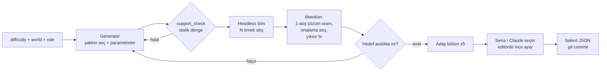

# 03 — Kule ve Bölüm Tasarım Sistemi

> Amaç: Her bölümde **farklı** bir kule; kule blokları **malzeme mantığına** ve **artan zorluğa** göre seçilir;
> zorluğu tek bir yerden (`game_data/difficulty.json`) yönetmek. Bölümler **yarı otomatik** üretilir: generator önerir → simülasyon doğrular → Sena/Claude seçip ince ayar yapar.

---

## 1. Türün dersleri (Smash Away ve benzerleri)
Smash Away mağaza sayfası oyunun özünü şöyle anlatıyor: yapıda bir nokta seç, topu at, gerisini fizik halleder; her aşamada belli sayıda top var;
yapıyı **bir arada tutan parçayı** ara (alttaki blok, kalabalık bir köşe, kenara yakın bir parça); yığınlar teneke, blok ve karışık malzemelerden oluşur
ve şekiller aşamadan aşamaya değişir. Buradan çıkan tasarım ilkeleri:

1. **Yük taşıyan katmanlar:** Kule katmanlardan oluşur; destek katmanını vurmak zincirleme çöküş başlatır. Yüzey bloğunu vurmak az iş görür.
2. **Okunabilirlik:** Oyuncu 2 saniyede "zayıf nokta şurası olabilir" diye tahmin edebilmeli.
3. **Malzeme = strateji:** Farklı malzemeler farklı top/atış ister.
4. **Şekil çeşitliliği:** Aynı şablon üst üste gelmemeli (ritim kuralı §6).
5. **Çift yapı bölümleri:** İki kule = "birini diğerine devir" (domino) veya "kalkanı aş, asıl kuleyi vur" bulmacası.

**Bizim farkımız:** her kulede tasarım gereği **1–3 "anahtar destek" (keystone)** bulunur. **Keystone = vurulunca en büyük çöküşü başlatan blok.**
Hedef "masayı temizle"dir (K-018: blok hacminin %80'i platformdan düşmeli); doğru keystone'a tek atış = hedefe tek atışta ulaşmak = 3 yıldız.
Kuleye gömülü Altın Küre de düşerse **jackpot** (ekstra altın, yıldızı etkilemez).
Böylece yıldız sistemi "şans" değil "zekâ" ödüllendirir.

---

## 2. Koordinat sistemi ve bölüm dosyası

- Birim: **grid birimi (1 = standart küp)**. Eksenler: **x** sağ (+) / sol, **y** yukarı, **z** ön (+, kameraya doğru) / arka.
- Platform merkezi `x = 0, z = 0`, platform üst yüzeyi `y = 0`. Platform üst yüzeyi `platform.width` (x) × `platform.depth` (z) dikdörtgendir; kenar kuralı (`02` §2) bu yüzeye göre çalışır.
- **Dar platform (K-018):** `clear_percent` bölümlerinde platform kulenin ayak izine yakın tutulur (her yönde ≈ 0.5–1 birim pay). Geniş platformda bloklar düşemez ve %80 hedefi imkânsızlaşır.
- Oynanabilir kule alanı: genişlik ≈ **10 birim** (x: −5…+5), derinlik ≈ **6 birim** (z: −3…+3), yükseklik ≈ **12 birim**.
- **Blok konumu:** `x, z` = bloğun taban merkezi, `y` = alt yüzeyi. **Dönüş:** `rot: [rx, ry, rz]` derece (Euler YXZ).
  Çoğu blok yalnızca `ry` ile (dikey eksen etrafında) döndürülür; eğik/devrik yerleşim için `rx` / `rz`.
- Top (cannon): platformun önünde, `rules.cannon.position` = `(0, 0, 6)` (K-016); bölüm `camera_override` ile kadrajı daraltabilir. Atış yönü 3D.

### 2.1 Bölüm JSON formatı (gerçek dosya: `game_data/levels/w01_akdeniz/w01_l03.json`)
```json
{
  "id": "w01_l03",
  "world": "akdeniz",
  "index": 3,
  "name_tr": "Üç Kemer",
  "difficulty": 10,
  "role": "build_up",
  "shots": 3,
  "objective": { "type": "clear_percent" },
  "aim_preview_dots": 17,
  "platform": { "width": 7.44, "depth": 2.6, "style": "limestone_plinth" },
  "structures": [
    { "template": "arch_shrine", "x": 0, "z": 0, "ry": 0, "seed": 1031, "params": { "floors": 2, "depth_layers": 1, "side_towers": true, "core": "hanging_center", "symmetry": 0.95 } }
  ],
  "blocks": [],
  "joints": [],
  "cores": [],
  "keystones": [],
  "tutorial": { "type": "hint", "text_tr": "Kemeri taşıyan desteğe nişan al!" },
  "intro_ball": null,
  "free_balls": {},
  "baked": false,
  "_doc": "Sablon tabanli ornek: blocks/cores/keystones generator tarafindan doldurulur; Faz 3 sonunda baked=true olarak dondurulur."
}
```
- **`structures`** = şablon çağrıları (kısa, okunur, değiştirmesi kolay).
- **`blocks`** = elle eklenen/değiştirilen bloklar (her bloğa otomatik `id`: `b01`, `b02`…).
- `baked: true` → generator çıktısı "dondurulmuş" tam liste (yayın sürümünde bölümler pişirilmiş olur, böylece şablon kodu değişse de bölüm bozulmaz).
- **Opsiyonel alanlar:** `camera_override` (`rules.camera` anahtarlarını bölüme özel ezer, ör. L01: `{ "distance": 14, "look_at_height": 3.0 }`);
  `modifiers_override` (dünya modifier'larını ezer, Faz 4+); `tutorial` (`{ "type": "hand_tap", "target_block": "b02", "text_tr": "…" }` → el keystone'u gösterir,
  veya `{ "type": "hint", "text_tr": "…" }` → yalnızca ipucu yazısı; çizimi Faz 2 UI'da).
- Elle tasarlanmış tam örnek: `w01_l01.json` (`baked: true`, blok listesi + `keystones` + `cores` + `camera_override`).
- **`objective`** (K-018): varsayılan `{ "type": "clear_percent" }`; hedef oranı `rules.objective_defaults.clear_percent_target`, bölüme özel `objective.target` (0–1) ile ezilebilir.
  Tek hedef `clear_percent` (K-030: `drop_core` / `drop_all_cores` kaldırıldı); `cores` **opsiyoneldir** ve her zaman jackpot küresidir. `cores[].y` = kürenin alt yüzeyi.

---

## 3. Blok şekilleri (`game_data/shapes.json`)
| id | Boyut (g×y×d) | Kullanım |
|---|---|---|
| `cube` | 1×1×1 | Temel blok, kristal, sandık (malzeme `crate`) |
| `half` | 1×0.5×1 | Döşeme, ince katman |
| `plank_s` / `plank_l` | 2×0.4×0.9 / 4×0.4×0.9 | Kalas, köprü, kiriş (ry=90 ile derinlik yönünde) |
| `beam` | 6×0.5×0.9 | Uzun kiriş (çift kule köprüsü) |
| `pillar_2` / `pillar_3` | 0.6×2×0.6 / 0.6×3×0.6 | Sütun |
| `slab_2x2` / `slab_3x3` | 2×0.3×2 / 3×0.3×3 | **Yeni:** kat döşemesi — derinlikli kulelerde sütun ızgarasının üstüne kat |
| `arch` | 3×2×1 (2 ayak + kemer) | Kemer — 3 kutu çarpışma şekli |
| `half_arch` | 1.5×2×1 | Yarım kemer (asimetrik) |
| `truss` | 3×1.5×0.8 | Ahşap üçgen kafes (görsel 03) |
| `wedge` | 1×1×1 üçgen prizma | Rampa, kama |
| `barrel` | ø0.8×1 | Fıçı (Korsan) — yuvarlanabilir, her yöne |
| `ring_hanger` | 1.5×1.5×1 | Altın Küre yuvası (U şekli) |
| `core_sphere` | ø0.9 | Altın Küre |

## 4. Yapı şablonları (template) — kule "dil bilgisi"
Her şablon parametreli bir fonksiyondur (`src/gameplay/level/templates/*.gd`), blok listesi döndürür.

| Şablon | Tanım | Keystone nerede | Zorluk aralığı |
|---|---|---|---|
| `stack_pyramid` | Kristal/küp piramit, tepede küre | Alt orta blok | 1–25 |
| `arch_shrine` | Ortada kemer, içinde asılı küre, iki yanda kule | Kemer ayakları, kiriş | 5–60 |
| `twin_pillars` | İki sütun + üstte kalas + üstünde yük | Sütunlardan biri | 1–30 |
| `truss_bridge` | Üçgen ahşap kafes + üstünde taş katlar (görsel 03 sol) | Kafesin orta dikmesi | 20–70 |
| `staircase` | Bir yana yaslanan basamak kule | Alt basamak | 10–50 |
| `cantilever` | Tek taraftan taşan kiriş, ucunda karşı ağırlık | Karşı ağırlık / mesnet | 30–80 |
| `fortress_wall` | Önde alçak kalkan duvar, arkada asıl kule | Duvarın üstünden lob atış | 40–90 |
| `hanging_core` | Küre zincire/halata asılı (görsel 02 sağ) | Zincir (Kesici/Alev), taşıyıcı kiriş | 30–90 |
| `seesaw_ramp` | Eğik kalas + mafsal (görsel 02 sol) | Rampanın ucu | 25–70 |
| `tall_needle` | Dar ve yüksek kule, yüksek küre | Üst üçte bir | 20–60 |
| `domino_row` | Yan yana dizili ince bloklar → zincirleme | İlk blok | 5–50 |
| `twin_towers` | İki ayrı kule (bkz. §5); yan yana veya önde–arkada | Biri diğerine devrilir | 35–100 |
| `grid_tower` | **Derinlikli:** 2×2 / 3×3 sütun ızgarası, her katta `slab` döşeme (Smash Away'in klasik kat kat kulesi) | Alt kattaki bir köşe/ön sütun | 1–70 |
| `ziggurat` | **Derinlikli:** her yöne daralan 3D basamaklı piramit, tepede küre | Alt kat ön-orta blok | 5–40 |
| `ring_fort` | **Derinlikli:** kare planlı 4 duvar, iç avluda yükseltilmiş küre | Ön duvarın orta-altı veya lob atış | 40–90 |
| `l_tower` | **Derinlikli:** L planlı asimetrik kule, yük tek kola binmiş | Kolların birleştiği köşe | 30–80 |

**Yazılan şablonlar (Faz 3):** `stack_pyramid` (keystone: ön sıranın alt-orta kristal küpü; bütçeye sığan en büyük piramit, tepede küre), `twin_pillars` (keystone: ön çerçevenin alt katındaki bir kristal sütun; kat sayısı `height`'tan, yük yığını en fazla 2 küp). `arch_shrine` (kemer = tek gövde, 3 kutu çarpışma; iki küp ayak üstünde, `floors` kat kemer; keystone: ön kemerin bir **kristal ayağı**; küre `ring_hanger` yuvasında — `core: "hanging_center"/"inside"` kemerin içinde, `"top"` en üst kirişte, `true` → `core_protection` 0 ise üstte, ≥1 ise içeride; gerçek asılı küre ip/zincir ile Faz 5'te), `staircase` (bir yana yaslanan basamaklar, yön seed'den; eğim `symmetry` ile artar ve her satırın üstündeki birleşik ağırlık merkezi 3 × `support_margin` içeride kalacak şekilde sınırlanır; keystone: yaslanan duvarın altındaki kristal küp — alt basamak tek başına bir şey taşımadığı için). `domino_row` (**en az 3 sıra yan yana**, her sıra kameradan uzağa −z yönünde dizili `pillar_3` ahşap dominolar — gülle hep kameradan uzağa ittiği için zincir yalnızca bu yönde işler: gerçek gülleyle x yönündeki dizi 60 dominodan 12'sini (yalnız vurulanları), z yönündeki 59'unu devirdi (Sena kararı); sıralar kısa tutulur, ayak izi genişlik ≥ derinlik; düşük bütçede bütçe aşılır; aralık yükseklik × 0.45 — fizikte ölçüldü: 0.45'te zincir 4/4 devriliyor, ≤0.40 ve `pillar_2` zinciri kesiyor; keystone: orta sıranın öndeki dominosu (devrilmesi için ahşap, kristal değil); en arkadaki dominoların tepesinde kristal; küre orta sıranın arkasında, zincir onu iter), `truss_bridge` (iki taş kolon → alt kiriş → **kristal orta dikme = keystone** + iki ahşap payanda (dikmenin önünde gülle genişliğinde kanal bırakır, yoksa dikme vurulamıyordu) → dikmeye dengelenmiş üst kiriş → uçlarda tek kat taş (iki kat, tek dikme üstünde `max_settle_drift`'i aştı), ortada küre). Her şablon testlerde zorluk 1/15/25 × 3 seed ile `LayoutCheck` (oyun alanı, kenar payı, keystone, kristal), `SupportCheck`, `KeystoneCheck` (kameradan görünürlük + toptan ulaşılabilirlik, kural 3) ve fizik kayma kontrolünden geçer (`tests/unit/test_templates_basic.gd`, `tests/unit/test_templates_arch_stair.gd`: ayrıca şablonun kendi zorluk aralığı, yuvadaki kürenin fizikte kıpırdamaması, kemer açıklığından görüşün kapalı sayılmaması, blok sayısının genişletmede ve sahnede eşleşmesi; `tests/unit/test_templates_domino_truss.gd`: gerçek domino zinciri fizikte kristale ve küreye ulaşıyor).

Her şablon ayrıca `depth_layers` (1–3) parametresi alır: kulenin z yönünde kaç sıra olduğu (`difficulty.json → curves.depth_layers`).
Düşük zorlukta 1 sıra (okunur, neredeyse düz), yüksek zorlukta 2–3 sıra (arkadaki destekler bulmacayı derinleştirir).

**Kurallar (her şablon uymak zorunda):**
1. **3D statik denge** (generator `support_check`):
   a. Her blok için taban ayak izinin altındaki destek yüzeyleriyle (platform veya alttaki bloklar) **kesişimi** bulunur; dönüşler (`rot`) hesaba katılır.
      Kesişimlerin xz düzlemindeki dışbükey zarfı = **destek poligonu**.
   b. Bloğun **ve üstündeki tüm yükün** birleşik ağırlık merkezinin (x, z) izdüşümü bu poligonun içinde ve kenarına en az `rules.physics.support_margin` uzaklıkta olmalı.
   c. Eğik bloklar (`rx`/`rz` ≠ 0) için destek, temas noktalarından hesaplanır.
   d. Son doğrulama fizikle: `pre_settle_sec` simülasyonunda hiçbir blok `rules.physics.max_settle_drift` birimden fazla kaymamalı.
   **Uygulama (Faz 3):** `src/gameplay/level/support_check.gd` → `SupportCheck.check(level)` (a–c, saf hesap; 120 blok ≈ 0.25 sn) ve
   `await SupportCheck.physics_drift(level, node)` (d). "Üstündeki yük" = bloğa doğrudan/dolaylı yaslanan her şey; bu grubun destek poligonu,
   grubun dışındaki cisimlerle temaslarından kurulur (iki sütun üstündeki kalas, her sütunun kontrolünde öbür sütundan da destek alır).
   Temas: aşağı bakan yüz, yukarı bakan yüzün `rules.physics.support_contact_epsilon` kalınlığındaki dilimine ve sınırına kırpılır
   (düz–düz, köşe ve kenar–kenar temasları). Altın Küre yalnızca yüktür. Testler: `tests/unit/test_support_check.gd`.
2. **Keystone garantisi:** Şablon en az 1 keystone işaretler (keystone = en büyük çöküşü başlatan blok); simülasyon bu bloğa vurulunca hedefin
   (varsayılan: blok hacminin `clear_percent_target` oranı platformdan düşer) gerçekleştiğini doğrular.
3. **Görüş hattı (S-007):** *(Otomatik kontrol: `src/gameplay/level/keystone_check.gd`; kameraya bakan yüzlerde `rules.level_checks.face_samples`² örnek nokta, görünür oran ≥ `keystone_min_visible_ratio`; ulaşılabilirlik: gülle yarıçapıyla `aim.arc` atışı veya `drag_pitch_max_deg`'e kadar sürükle-bırak lobu, ilk çarptığı keystone olmalı.)* v1'de kamera sabittir; bu yüzden **her keystone varsayılan kamera açısından (`rules.camera`) görünür olmalı** — en az bir yüzü önden/üstten açıkça görünür, başka bloğun arkasında saklı değil. Ayrıca toptan **doğrudan ya da lob atışla** ulaşılabilir olmalı. Arkada saklı veya önü tamamen kapalı keystone yasak. (Kamera döndürme v2'de gelirse bu kural yeniden değerlendirilir.)
4. **Simetri ayarı:** `symmetry` parametresi 0–1; düşük zorlukta simetrik (okunur), yüksekte asimetrik (şaşırtıcı).
5. **Kenar payı:** Bloklar platform kenarından en az 0.3 birim (`rules.physics.spawn_edge_inset`) içeride doğar; aksi halde kenar kuralı (`02` §2) bölüm başında yanlış "düştü" sayabilir.
6. **Altın Küre yerleşimi (K-018):**
   a. Küre her bölümde yalnızca **jackpot**tır (K-030, bölümü asla bitirmez): kulenin **içine** (bloklarla çevrili), **kemer altına** veya **tepeye** gömülür. Keystone çöküşüyle
      düşebilir ama garanti değildir; zorluk arttıkça daha derine gömülür (`core_protection`). Küre temizlik oranına katılmaz, yıldızı etkilemez.
   b. ~~`drop_core` bölümleri~~ — K-030 ile kaldırıldı (küreyi tek atışla düşürüp bölümü bitirmek kule yıkmayı anlamsızlaştırıyordu).
7. **Dar platform:** `clear_percent` bölümlerinde platform kulenin ayak izine yakın tutulur (§2); blokların %80'i düşebilmeli.

## 5. Çift kule ve çoklu yapı mantığı
`structures` dizisinde birden çok şablon → aynı platformda veya **ayrı platformlarda** (Gökyüzü Adaları).

| Desen | Kurgu | Oyuncunun keşfi |
|---|---|---|
| **Domino ikilisi** | Uzun ince kule A (küresiz) + yanında asıl kule B (küreli). Gülle sayısı az. | "A'yı B'nin üstüne devirirsem ikisini birden yıkarım" |
| **Kalkan + hedef** | Önde (+z) ağır taş kalkan, arkada (−z) kırılgan kule | "Kalkanı değil, üstünden lob at" veya Çekim Topu |
| **Köprülü ikiz** | İki kule arasında `beam` köprü, küre köprünün ortasında | "Köprüyü taşıyan bir kuleyi yık" |
| **İki küre** (iki jackpot) | Her kulede bir jackpot küresi | Atış ekonomisi: tek atışla ikisini düşürecek açı (bölümü yine temizlik bitirir) |
| **Boss** | 3 yapı, 5 gülle, karışık malzeme, dünya modifier'ı maksimum | Dünyada öğrenilen her şey |

## 6. Zorluk sistemi (`game_data/difficulty.json`)

### 6.1 Tek sayı: `difficulty` (1–100)
Her bölüm bir zorluk puanı taşır. Generator bu puanı **parametrelere** çevirir; tablolar `difficulty.json`'da, **elle değiştirilebilir**:

| Parametre | d=1 | d=50 | d=100 | Etki |
|---|---|---|---|---|
| `block_count` | 6 | 28 | 60 | Daha çok blok = daha çok kütle |
| `height` (birim) | 3 | 7 | 11 | Yüksek küre = zor erişim |
| `heavy_ratio` (taş/metal oranı) | 0.1 | 0.45 | 0.75 | Ağır malzeme = az yıkım |
| `redundancy` (yedek destek) | 0 | 1 | 3 | Keystone kırılsa da ayakta kalma |
| `core_protection` | 0 | 1 | 3 | Küre etrafındaki koruyucu katman / gömülme derinliği (jackpot zorlaşır) |
| `shots` | 3 | 3 | 4–5 | Zor bölümlerde ekstra hak (oyuncuyu sinirlendirmemek için) |
| `aim_preview_dots` | 20 | 12 | 6 | Kısa yörünge = tahmin zorlaşır |
| `symmetry` | 1.0 | 0.6 | 0.2 | |
| `depth_layers` | 1 | 1–2 | 3 | Kulenin z yönünde kaç sıra olduğu (derinlik) |
| `modifier_strength` | 0 | 0.6 | 1.0 | Dünya kuralının şiddeti (rüzgâr, kayganlık…) |

Ara değerler **doğrusal interpolasyon** (veya `difficulty.json`'daki eğri noktaları). Global çarpan: `difficulty.global_multiplier`
(tüm oyunu bir tıkla %10 kolaylaştır/zorlaştır).

**Zorluk nasıl artar (K-018, mevcut eğrilerle):** daha çok ve daha ağır blok (`block_count`, `heavy_ratio`), dağınık veya ikiz kuleler
(`structure_count`, `twin_towers`), daha az gülle, kürenin daha derine gömülmesi (`core_protection`).
> Not (Sena, 2026-11-18): `curves.shots` bilerek zorlukla artar (3 → 5): zor bölümlerde blok sayısı çok arttığı için 4–5 gülle yine sıkıdır.
> "Daha az gülle" kule büyüklüğüne göre az gülle anlamındadır; eğri aynen kalır.

### 6.2 Bölüm ritmi (dünya başına 10 bölüm) — "testere dişi" eğri
```
zorluk
 ^                                   ▲B10 (boss)
 |                          ▲8
 |              ▲6    ▲7          ▼9
 |        ▲3 ▼4    ▲5
 |  ▲1 ▲2
 +---------------------------------------> bölüm
```
| Bölüm | Rol (`role`) | Açıklama |
|---|---|---|
| 1 | `intro` | Dünyaya giriş, kolay, yeni arka planı göster |
| 2–3 | `build_up` | Dünyanın imza malzemesi ve modifier'ı tanıtılır |
| 4 | `breather` | Kolay ama **çok tatmin edici** (bol kristal, büyük çöküş) |
| 5 | `new_mechanic` | Yeni top/mekanik tanıtımı (varsa) |
| 6–7 | `combine` | Mekanikleri birleştir |
| 8 | `challenge` | Zor |
| 9 | `breather` / `spectacle` | Görsel şov, nefes alma |
| 10 | `boss` | Çoklu yapı, en zor, büyük ödül |

Dünya başlangıç zorluğu bir önceki dünyanın ortası civarı: `world_base = 8 + (world_index-1) * 10`, bölüm ofsetleri `difficulty.json → rhythm`.

### 6.3 Malzeme mantığı (dünya paleti)
Generator blok malzemesini rastgele değil **dünya paleti + zorluk** ile seçer:
- `worlds.json → palette`: `{ "stone": 0.4, "wood": 0.3, "crystal_amber": 0.15, "crystal_cyan": 0.15 }`
- Zorluk arttıkça `heavy_ratio`'ya göre taş/metal payı artar, kristal payı azalır (ama asla 0 olmaz — her kulede kırılacak parlak şey olmalı).
- **Rol kuralları:** Sütunlar/temeller ağır malzeme; üst katlar hafif; keystone'lar **görsel olarak ayırt edilebilir** (ör. ahşap kiriş taş kulede).
- Top tanıtım bölümünde paletin ağırlığı o topun güçlü olduğu malzemeye kayar (Alev → ahşap %60).
- **Malzeme rolleri (K-022):** **kristal** tek doğrudan vuruşta kırılır (parlak, tatmin edici hedef; keystone için ideal);
  **ahşap/sandık** orta dayanıklı (ağır topla birkaç vuruş, özel toplarla — alev, kesici — hızlı yok olur);
  **taş/metal** neredeyse kırılmaz, **devrilerek** temizlenir (yapının iskeleti; tasarım onları düşürmeye dayanmalı, kırmaya değil).
  Kesin hp/eşik sayıları Faz 6–9'da `/ordino-balance` ile ayarlanır.
- **Uygulama (Faz 3 Adım 6, `src/gameplay/level/material_picker.gd`):** şablon blokları rol verir (`structure` / `light` / `crystal`); palet katıları
  ortalama yoğunluğa göre ağır/hafif ayrılır (Akdeniz: taş ağır, ahşap hafif), seçimler palet ağırlıklı. Kristal olmayan blokların `heavy_ratio` kadarı ağır:
  önce taşıyıcılar, sonra alttan yukarı. `role_overrides.breather.crystal_ratio_min` en üst blokları kristale çevirir. **Top tanıtım bölümü:**
  bölümün `intro_ball`'u veya `tutorial_level_id`'si bu bölüm olan top varsa kristal olmayanların en az `difficulty.intro_ball.strong_material_share`'i (0.6)
  o topun `damage_mult > 1` olduğu malzemelerden (W1 L08 Alev → ahşap). Keystone en yaygın malzemeden farklı olur (devrilmesi gereken keystone kristal olmaz).
  **Ayna çiftleri** (aynı şekil/rol/yükseklik/|x|/z) aynı malzemeyi alır — taş + ahşap yük, tek dikmeye dengelenmiş kirişi deviriyordu.
  > Not: Alev Topu davranışı Faz 5'te gelir; L08'in "alevle tek atışta yanma" iddiası ancak orada simülasyonla doğrulanabilir.
- **Küre koruması (`core_protection`, kural 6a):** 0 = küre açıkta; 1 = `ring_hanger` yuvasında; ≥2 = yuva + üstünde `plank_s` kapak (dikmelerin tepesine oturur).
  `staircase`'te küre en alt basamakta durur (eğik duvarın tepesinde sallanıp `max_settle_drift`'i aşıyordu); `domino_row`'da küreyi zincirin kendisi korur (yuva yok);
  `arch_shrine` `inside` modunda küre her zaman kemerin altında yuvadadır.

## 7. Top tanıtım bölümü tarifi
Örnek — Alev Topu (W1 B8):
- Kule: ahşap kafes + sandıklar ağırlıklı, küre ahşap kiriş üstünde, taş kalkan önde.
- Ağır topla 3 atışta **zor**, Alev topuyla **tek atışta** muhteşem yanma zinciri.
- Bölüme girerken: "Yeni! Alev Topu" kartı + 1 bedava top (`free_balls: {"fire": 1}`), top seçicide yanıp söner.

## 8. Üretim hattı (pipeline)



**Uygulama (Faz 3 Adım 7, `src/gameplay/level/level_generator.gd`):**
- **Plan** (`plan_world`): dünyanın her bölümüne bir şablon. Dosyası olan bölüm kendi şablonunu korur (elle / baked JSON'a asla dokunulmaz).
  Diğerleri: `worlds.allowed_templates` ∩ yazılmış şablonlar ∩ `difficulty.templates` aralığı zorluğu kapsayanlar; önceki bölümle (ve dosyası olan sonraki
  bölümle) aynı olamaz; aralarından dünyada en az kullanılanlar, eşitlikte seed (`rules.generator.base_seed`). Aynı girdi + seed = aynı kule.
- **Üretim** (`generate`): yapı sayısı `structure_count` eğrisinden (boss: `role_overrides.boss.structure_count_min`, asla altına inilmez); bütçe yapılara bölünür;
  üretilen blok / bütçe `generator.budget_warn_below`'un altındaysa yan yana ek yapı (en çok `generator.max_structures`, oyun alanına sığdıkça, aralık
  `generator.structure_gap`); hâlâ altındaysa raporda uyarı. Platform = tüm blokların ayak izi + pay.
- **Yeniden deneme:** her deneme kendi alt-seed'i; `LevelChecks` (yerleşim, denge, her yapının keystone görüş/erişim) + fizik kayma. `generator.max_attempts`
  aşılırsa kural gevşetilmez: hata + hangi kontrolün kaç kez düştüğü raporlanır.
- **Elle bölümler** (`difficulty.handmade_levels` = 1, 4, 9, 10): dosyası yoksa generator yalnızca **aday** üretir (kaynak "generator adayı (elle yapılacak)").
- **Oyunda:** N/B dünyanın 10 bölümünde gezer; dosya varsa dosya, yoksa generator çıktısı (oturum boyunca önbellekte). Kaynak Dev Panel'de ve alttaki bilgi satırında.

### 8.1 Simülasyon metrikleri ve hedefler (`difficulty.json → sim_targets`)
- **Çözüm** (K-018) = bölüm hedefine ulaşmak. Tek hedef `clear_percent`: blok hacminin `clear_percent_target` (0.8) oranı platformdan düşer (K-030).
- `one_shot_solve_rate`: rastgele örneklenen 200 atış noktasından kaçı tek atışta çözüyor.
  - intro: %30–60 · build_up: %10–30 · challenge: %2–8 · boss: %0.5–3 (ama 0 olamaz!)
  - **İstisna — W1 L01 (FTUE):** rastgele atış oranı ~%15 (hedefin altında) kabul edildi; tutorial eli keystone'u gösterdiği için
    oyuncu ilk atışı keystone'a yapar (keystone atışı 20/20 çözüm, K-021).
- `any_solve_rate_within_shots`: verilen atışla çözülebilirlik (açgözlü strateji ile) ≥ %20 olmalı.
- `keystone_check`: her keystone'a doğrudan atış → hedef gerçekleşmeli (en az birinde).
- `collapse_ratio`: atış başına platformdan düşen blok hacmi oranı (tatmin ölçüsü); keystone vuruşunda `min_collapse_ratio` (0.5) ve üstü tercih edilir.
- `jackpot_rate` (`clear_percent`): çözümlerin kaçında Altın Küre de düşüyor. Öneri: intro %50–80 → challenge %10–25. Şimdilik yalnızca raporlanır;
  `difficulty.json → sim_targets`'a eşik eklemek Sena'nın onayına bağlı (`_TODO_SENA`).

**Uygulama (Faz 3 Adım 8):** `src/tools/sim/level_sim.gd` (+ komut satırı `src/tools/sim/sim_cli.gd`):
`godot --headless --fixed-fps 60 --path . -s src/tools/sim/sim_cli.gd -- --world akdeniz` (veya `--level w01_l05`, `--samples N`, `--greedy N`, `--batch K`).
Gerçek `Ball` + bloklar (hasar, kırılma, kenar kuralı); bölümün `batch` kopyası aynı fizik dünyasında 40 m arayla paralel; `--fixed-fps` ile her kare bir fizik adımı (deterministik, CPU hızında).
Rastgele hedefler = varsayılan kameradan görünen blok yüzü noktaları (oyuncunun dokunabileceği yerler), `aim.arc` atışı. `within_shots_rate` için "açgözlü" strateji:
ilk atış rastgele, sonrakiler platformda kalan en büyük bloğa. Çıktı: `_sim_reports/<id>.json` + `summary.md` (git dışı). Hiçbir bölümü değiştirmez.

**İlk ölçüm — Dünya 1, 200 örnek (2026-11-19, yalnızca rapor; karar Sena'nın):**

| Bölüm | Kaynak | Rol | Tek atış (hedef) | Keystone çözüm / çöküş | Jackpot | Gülleyle çözüm (≥%20) | Yere değen hacim |
|---|---|---|---|---|---|---|---|
| L01 | elle | intro | %42 (30–60) ✔ | ✔ / %86 | %100 | %56 ✔ | %27 |
| L02 | generator | build_up | %0 (10–30) ⚠ | ✘ / %33 | – | %0 ⚠ | %76 |
| L03 | dosya | build_up | %0 (10–30) ⚠ | ✘ / %56 | – | %0 ⚠ | %37 |
| L04 | aday | breather | %0 (25–55) ⚠ | ✘ / %50 | – | %21 ✔ | %50 |
| L05 | generator | new_mechanic | %21 (10–35) ✔ | ✘ / %54 | %43 | %52 ✔ | %21 |
| L06 | generator | combine | %0 (6–20) ⚠ | ✘ / %30 | – | %8 ⚠ | %40 |
| L07 | generator | combine | %0 (6–20) ⚠ | ✘ / %10 | – | %6 ⚠ | %40 |
| L08 | generator | challenge | %0 (2–8) ⚠ | ✘ / %33 | – | %0 ⚠ | %76 |
| L09 | aday | breather | %0 (25–55) ⚠ | ✘ / %30 | – | %2 ⚠ | %40 |
| L10 | aday (boss) | boss | %0 (1–3) ⚠ | ✘ / %26, %28 | – | %0 ⚠ | %50 |

Süre: bölüm başına 13–17 sn (boss 31 sn), Dünya 1 toplam ~2 dk 48 sn → 200 örnek uygun. Aynı girdi iki kez → birebir aynı sonuç.
Bulgular: (1) Hedefe ulaşan iki bölüm "yere değen hacim"i en düşük olanlar (L01 %27, L05 %21): ince ayaklı "masa" kuleler keystone kırılınca bütünüyle devriliyor,
geniş tabanlı şablonlarda taban (taş) platformda kalıyor ve hacim %80'e ulaşmıyor. (2) Platform payının etkisi küçük (deney: `platform_margin` 0.5 → 0, keystone
çöküşü en çok +%10). (3) L01 keystone %86 = K-021 ölçümüyle aynı (aracın doğrulaması). Açık karar (Sena): şablon tasarımı / hedef oranı / ölçüm biçimi.

**Yere değen hacim tavanı (Sena, 2026-11-20 — ilk ölçümden sonra; K-018 ve `sim_targets` değişmedi):**
- Ölçü: `LevelChecks.ground_contact_ratio` = platforma değen blokların hacmi / toplam blok hacmi (küre hariç).
- Tavan: `difficulty.curves.ground_contact_max_ratio` (d1 %30 → d50 %40 → d100 %50; zorlukla artar) ve kolay rollerde
  `role_overrides.{intro, build_up, breather}.ground_contact_max_ratio = 0.30` (ikisinin küçüğü). Başlangıç değerleri ölçümden: hedefe ulaşan
  L01 %27, L05 %21 → kolay roller %30.
- Generator: tavanı ve bütçe üst sınırını (`rules.generator.budget_max_over` = %25: blok sayısı ≤ bütçe × 1.25) **yeniden deneme koşulu** olarak uygular
  (kontrol grupları `ground`, `budget`); planda yalnızca bu sınırlara bir varyantıyla uyabilen şablonlar seçilir (art arda tekrar yasağı aynen).
- Varyantlar (`TowerTemplate.variants()`, her denemede sıradaki): `stack_pyramid` ve `staircase` → **yükseltilmiş** (`raised`: yapı, iki ayak + kirişten
  oluşan bir güvertenin üstüne; ön ayaklardan biri kristal keystone — kırılınca güverte tüm yapıyla devrilir); `arch_shrine` → yan kulesiz + **yarım küp ayak**.
- `domino_row` tüm dominolar yere bastığı için (%76) Dünya 1'in hiçbir bölümüne uymuyor → Dünya 1 planında yok (L02'nin bütçe aşımı da böylece çözüldü).
- Dosya bölümleri değişmez: L03 (%37 > %30) raporlanır.

**İkinci ölçüm — aynı kurallar + tavan (200 örnek, 2026-11-20). Eski → yeni:**

| Bölüm | Rol | Şablon (eski → yeni) | Yere değen (tavan) | Tek atış (hedef) | Keystone çöküş | Gülleyle çözüm (≥%20) |
|---|---|---|---|---|---|---|
| L01 | intro | elle | %27 (%30) | %42 → %42 ✔ (30–60) | %86 ✔ | %56 ✔ |
| L02 | build_up | domino → yükseltilmiş piramit | %76 → %24 | %0 → **%44** ⚠ (10–30, fazla kolay) | %33 → %46 | %0 → %91 ✔ |
| L03 | build_up | dosya (kemer) | %37 (%30) | %0 → %0 ⚠ | %56 | %0 ⚠ |
| L04 | breather | piramit → ikiz sütun | %50 → %21 | %0 → %20 ⚠ (25–55) | %50 → %54 | %21 → %71 ✔ |
| L05 | new_mechanic | ikiz sütun → yükseltilmiş merdiven | %21 → %16 | %21 → %13 ✔ | %54 → %56 | %52 → %67 ✔ |
| L06 | combine | merdiven → ikiz sütun + kemer | %40 → %22 | %0 → %0 ⚠ (6–20) | %30 → %49 | %8 → %9 ⚠ |
| L07 | combine | piramit → kemer | %40 → %24 | %0 → %0 ⚠ | %10 → %46 | %6 → %0 ⚠ |
| L08 | challenge | domino → merdiven | %76 → %33 | %0 → %0 ⚠ (2–8) | %33 → %27 | %0 → %0 ⚠ |
| L09 | breather | merdiven → yükseltilmiş piramit | %40 → %16 | %0 → **%32** ✔ (25–55) | %30 → %45 | %2 → %94 ✔ |
| L10 | boss | ikiz+domino → merdiven + ikiz sütun | %50 → %26 | %0 → %0 ⚠ (1–3) | %27 → %12 | %0 → %0 ⚠ |

Özet: hedefte olan bölüm 2 → 3 (L01, L05, L09); "gülleyle çözüm" 3 → 6 bölümde ✔. Kolay roller artık çözülebiliyor (L02 hatta hedefin üstünde, L04 hafif altında);
orta/zor rollerde (combine, challenge, boss) tek atış hâlâ %0 ve hiçbir generator keystone'u tek başına %80'e ulaşmıyor (en iyi %56). Süre: Dünya 1 ~1.5 dk.
Hiçbir kule / hedef / sayı değiştirilmedi; karar Sena'nın.

**8b — simülasyon generator döngüsünde (Sena, 2026-11-20; K-031; `sim_targets` değişmedi):**
- **`keystone_clear_min`:** kule kabul edilmeden önce her keystone'a `rules.generator.keystone_shots` (3) doğrudan atış (merkez + yüzünde başka noktalar);
  en iyi keystone'da atışların en az `keystone_shot_success_share`'i (0.5) `clear_percent` hedefine (0.8) ulaşmalı. Zorluk keystone'u bulmaktan / vurmaktan gelir, çökmeyen keystone'dan değil.
- **Gülleyle çözüm:** `generator.sim_greedy_samples` (20) açgözlü deneme; oran `sim_targets.min_solve_rate_within_shots`'ın (0.2) altındaysa kule reddedilir.
- **Zincir:** çok yapılı kulede sonraki yapılar birincinin **keystone tarafına** konur (keystone kırılınca kalas/kemer/duvar/güverte o yana devrilir).
  Her şablonun deneme payının ilk yarısı çok yapılı, ikinci yarısı tek yapı ("zincir kurulamadı, tek yapı" raporlanır; boss için de geçerli).
- **Yedek şablon:** planlanan şablon geçemezse denemeler, o bölüme uyan ve iki komşunun planlı şablonundan farklı diğer şablonlara eşit paylaştırılır ("plan X geçmedi").
- Sınıra (`max_attempts`) varılırsa kural gevşetilmez: hata + kontrol başına düşme sayısı + son sebep.
- L03: yan kulesiz, **yarım küp ayaklı** kemer (platform 5.4 × 2.6, yere değen %23).

**Üçüncü ölçüm — 8b sonrası (200 örnek, 2026-11-20; izole fizik dünyası). Önceki (yere değen tavanı) → şimdi:**

| Bölüm | Rol | Şablon (önce → şimdi) | Tek atış (hedef) | En iyi keystone (merkez atış) | Gülleyle çözüm (≥%20) |
|---|---|---|---|---|---|
| L01 | intro | elle | %42 → %37 ✔ (30–60) | ✔ %86 | %56 → %53 ✔ |
| L02 | build_up | yükseltilmiş piramit | %44 → %37 ⚠ (10–30) | ✘ %63 | %91 → %90 ✔ |
| L03 | build_up | kemer → **yarım ayaklı kemer** | %0 → **%14** ✔ | ✔ %82 | %0 → %59 ✔ |
| L04 | breather | ikiz sütun | %20 → %23 ⚠ (25–55) | ✘ %40 | %71 → %72 ✔ |
| L05 | new_mechanic | yük. merdiven → **kemer** (plan geçmedi) | %13 → %45 ⚠ (10–35) | ✔ %93 | %67 → %88 ✔ |
| L06 | combine | ikiz + kemer → **yük. piramit** (plan ikiz geçmedi) | %0 → %30 ⚠ (6–20) | ✘ %53 | %9 → %88 ✔ |
| L07 | combine | kemer | %0 → %46 ⚠ (6–20) | ✔ %93 | %0 → %89 ✔ |
| L08 | challenge | merdiven → **üretilemedi** | – | 12 denemede keystone ≤%85 (yarısı tutmuyor) | – |
| L09 | breather | yük. piramit → **kemer** (plan geçmedi) | %32 → **%54** ✔ (25–55) | ✔ %93 | %94 → %60 ✔ |
| L10 | boss | merdiven + ikiz → **üretilemedi** | – | 12 denemede keystone ≤%75 (2 deneme alana sığmadı) | – |

Özet: üretilen 8 bölümün hepsi artık tek keystone atışıyla çözülebilir ve gülleyle çözüm her yerde ≥ %20 (önce 3 bölümde %0'dı). Ama **tek atış oranı orta/zor rollerde
hedefin çok üstüne çıktı** (combine %30–46, hedef %6–20) — rastgele atış da büyük çöküş yapıyor. L08 (challenge) ve L10 (boss) hiçbir şablonla keystone %80'i
tutturamadı → **üretilemedi** (kural gevşetilmedi). Merkezden tek keystone atışı bazı kabul edilen bölümlerde ✘ (L02, L04, L06): generator 3 atışın yarısını
yeterli sayıyor (merkez dışı noktalar tutuyor). Süre: Dünya 1 ~1.4 dk; test seti 6 dk 45 sn → ~30 sn (`--fixed-fps`).
Not: 8b'nin ara ölçümü `Engine.time_scale` ile hızlandırılmıştı ve bu fizik adımını büyüttüğü için geçersizdi (yayınlanmadı); yukarıdaki tablo doğru adımla.

### 8.2 Bölüm editörü (Godot editör eklentisi, Faz 3)
> **K-024:** Faz 3'te özel ızgara editörü yerine Godot editör paneli yapılır: butonlar aşağıdaki gibi, bloklar Godot'un 3D gizmo'su ile taşınır. Aşağıdaki üç panelli düzen ileride değerlendirilir.
- Sol panel: şablon/blok paleti · Orta: grid üzerinde sürükle-bırak · Sağ: seçili bloğun malzemesi, döndürme, keystone işareti.
- Butonlar: **Test Et** (oyunu bu bölümle başlat) · **Simüle Et** (metrikleri göster) · **Kaydet (JSON)** · **Yeniden Üret (seed)**.
- Claude'a da yaptırılabilir: `/ordino-level-designer w02 bölüm 6'yı daha zor yap, halat ekle`.

## 9. 80 bölüm için başlangıç planı
- Her dünya için `difficulty.json → rhythm` ile 10 bölümün zorluk ve rolü otomatik belirlenir.
- Faz 9'da generator her bölüm için 5 aday üretir → en iyiler seçilir → elle cilalanır.
- Bölümlerin %20'si (her dünyada 1, 4, 9, 10) **elle tasarlanır** (imza anlar); geri kalanı generator + ince ayar.
