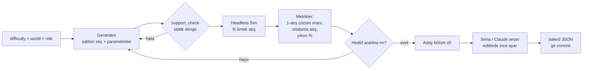

# 03 — Kule ve Bölüm Tasarım Sistemi

> Amaç: Her bölümde **farklı** bir kule; kule blokları **malzeme mantığına** ve **artan zorluğa** göre seçilir;
> zorluğu tek bir yerden (`game_data/difficulty.json`) yönetmek. Bölümler **yarı otomatik** üretilir: generator önerir → simülasyon doğrular → Sena/Claude seçip ince ayar yapar.

---

## 1. Türün dersleri (Smash Away ve benzerleri)
Smash Away mağaza sayfası oyunun özünü şöyle anlatıyor: yapıda bir nokta seç, topu at, gerisini fizik halleder; her aşamada belli sayıda top var;
yapıyı **bir arada tutan parçayı** ara (alttaki blok, kalabalık bir köşe, kenara yakın bir parça); yığınlar teneke, blok ve karışık malzemelerden oluşur
ve şekiller aşamadan aşamaya değişir. Buradan çıkan tasarım ilkeleri:

1. **Yük taşıyan katmanlar:** Kule katmanlardan oluşur; destek katmanını vurmak zincirleme çöküş başlatır. Yüzey bloğunu vurmak az iş görür.
2. **Okunabilirlik:** Oyuncu 2 saniyede "zayıf nokta şurası olabilir" diye tahmin edebilmeli.
3. **Malzeme = strateji:** Farklı malzemeler farklı top/atış ister.
4. **Şekil çeşitliliği:** Aynı şablon üst üste gelmemeli (ritim kuralı §6).
5. **Çift yapı bölümleri:** İki kule = "birini diğerine devir" (domino) veya "kalkanı aş, asıl kuleyi vur" bulmacası.

**Bizim farkımız:** her kulede tasarım gereği **1–3 "anahtar destek" (keystone)** bulunur. **Keystone = vurulunca en büyük çöküşü başlatan blok.**
Hedef "masayı temizle"dir (K-018: blok hacminin %80'i platformdan düşmeli); doğru keystone'a tek atış = hedefe tek atışta ulaşmak = 3 yıldız.
Kuleye gömülü Altın Küre de düşerse **jackpot** (ekstra altın, yıldızı etkilemez).
Böylece yıldız sistemi "şans" değil "zekâ" ödüllendirir.

---

## 2. Koordinat sistemi ve bölüm dosyası

- Birim: **grid birimi (1 = standart küp)**. Eksenler: **x** sağ (+) / sol, **y** yukarı, **z** ön (+, kameraya doğru) / arka.
- Platform merkezi `x = 0, z = 0`, platform üst yüzeyi `y = 0`. Platform üst yüzeyi `platform.width` (x) × `platform.depth` (z) dikdörtgendir; kenar kuralı (`02` §2) bu yüzeye göre çalışır.
- **Dar platform (K-018):** `clear_percent` bölümlerinde platform kulenin ayak izine yakın tutulur (her yönde ≈ 0.5–1 birim pay). Geniş platformda bloklar düşemez ve %80 hedefi imkânsızlaşır.
- Oynanabilir kule alanı: genişlik ≈ **10 birim** (x: −5…+5), derinlik ≈ **6 birim** (z: −3…+3), yükseklik ≈ **12 birim**.
- **Blok konumu:** `x, z` = bloğun taban merkezi, `y` = alt yüzeyi. **Dönüş:** `rot: [rx, ry, rz]` derece (Euler YXZ).
  Çoğu blok yalnızca `ry` ile (dikey eksen etrafında) döndürülür; eğik/devrik yerleşim için `rx` / `rz`.
- Top (cannon): platformun önünde ve biraz aşağıda, ≈ `(0, -1, +8)`; dünya bazında JSON'dan. Atış yönü 3D.

### 2.1 Bölüm JSON formatı (`game_data/levels/w01_akdeniz/w01_l03.json`)
```json
{
  "id": "w01_l03",
  "world": "akdeniz",
  "index": 3,
  "name_tr": "Üç Kemer",
  "difficulty": 14,
  "role": "build_up",
  "shots": 3,
  "objective": { "type": "clear_percent" },
  "aim_preview_dots": 14,
  "platform": { "width": 9, "depth": 5, "style": "stone_island" },
  "structures": [
    { "template": "arch_shrine", "x": 0, "z": 0, "ry": 0, "params": { "floors": 2, "depth_layers": 2, "core": "hanging_center" } }
  ],
  "blocks": [
    { "shape": "cube", "mat": "crystal_amber", "x": -3, "y": 0, "z": 1, "rot": [0, 45, 0] }
  ],
  "joints": [],
  "cores": [ { "x": 0, "y": 3.2, "z": 0, "attach": "chain", "attach_to": "b12" } ],
  "keystones": ["b04", "b07"],
  "camera_override": null,
  "modifiers_override": {},
  "intro_ball": null,
  "free_balls": {},
  "baked": false,
  "_doc": "structures şablondan blok üretir; blocks elle ek/override bloklardır. baked=true ise blocks tam listedir ve şablon yok sayılır. Konum x,y,z (y = alt yüzey), rot = [rx, ry, rz] derece."
}
```
- **`structures`** = şablon çağrıları (kısa, okunur, değiştirmesi kolay).
- **`blocks`** = elle eklenen/değiştirilen bloklar (her bloğa otomatik `id`: `b01`, `b02`…).
- `baked: true` → generator çıktısı "dondurulmuş" tam liste (yayın sürümünde bölümler pişirilmiş olur, böylece şablon kodu değişse de bölüm bozulmaz).
- **`objective`** (K-018): varsayılan `{ "type": "clear_percent" }`; hedef oranı `rules.objective_defaults.clear_percent_target`, bölüme özel `objective.target` (0–1) ile ezilebilir.
  `drop_core` / `drop_all_cores` bölümlerinde `cores` zorunlu; `clear_percent` bölümlerinde `cores` **opsiyoneldir** (jackpot küresi). `cores[].y` = kürenin alt yüzeyi.

---

## 3. Blok şekilleri (`game_data/shapes.json`)
| id | Boyut (g×y×d) | Kullanım |
|---|---|---|
| `cube` | 1×1×1 | Temel blok, kristal, sandık (malzeme `crate`) |
| `half` | 1×0.5×1 | Döşeme, ince katman |
| `plank_s` / `plank_l` | 2×0.4×0.9 / 4×0.4×0.9 | Kalas, köprü, kiriş (ry=90 ile derinlik yönünde) |
| `beam` | 6×0.5×0.9 | Uzun kiriş (çift kule köprüsü) |
| `pillar_2` / `pillar_3` | 0.6×2×0.6 / 0.6×3×0.6 | Sütun |
| `slab_2x2` / `slab_3x3` | 2×0.3×2 / 3×0.3×3 | **Yeni:** kat döşemesi — derinlikli kulelerde sütun ızgarasının üstüne kat |
| `arch` | 3×2×1 (2 ayak + kemer) | Kemer — 3 kutu çarpışma şekli |
| `half_arch` | 1.5×2×1 | Yarım kemer (asimetrik) |
| `truss` | 3×1.5×0.8 | Ahşap üçgen kafes (görsel 03) |
| `wedge` | 1×1×1 üçgen prizma | Rampa, kama |
| `barrel` | ø0.8×1 | Fıçı (Korsan) — yuvarlanabilir, her yöne |
| `ring_hanger` | 1.5×1.5×1 | Altın Küre yuvası (U şekli) |
| `core_sphere` | ø0.9 | Altın Küre |

## 4. Yapı şablonları (template) — kule "dil bilgisi"
Her şablon parametreli bir fonksiyondur (`src/gameplay/level/templates/*.gd`), blok listesi döndürür.

| Şablon | Tanım | Keystone nerede | Zorluk aralığı |
|---|---|---|---|
| `stack_pyramid` | Kristal/küp piramit, tepede küre | Alt orta blok | 1–25 |
| `arch_shrine` | Ortada kemer, içinde asılı küre, iki yanda kule | Kemer ayakları, kiriş | 5–60 |
| `twin_pillars` | İki sütun + üstte kalas + üstünde yük | Sütunlardan biri | 1–30 |
| `truss_bridge` | Üçgen ahşap kafes + üstünde taş katlar (görsel 03 sol) | Kafesin orta dikmesi | 20–70 |
| `staircase` | Bir yana yaslanan basamak kule | Alt basamak | 10–50 |
| `cantilever` | Tek taraftan taşan kiriş, ucunda karşı ağırlık | Karşı ağırlık / mesnet | 30–80 |
| `fortress_wall` | Önde alçak kalkan duvar, arkada asıl kule | Duvarın üstünden lob atış | 40–90 |
| `hanging_core` | Küre zincire/halata asılı (görsel 02 sağ) | Zincir (Kesici/Alev), taşıyıcı kiriş | 30–90 |
| `seesaw_ramp` | Eğik kalas + mafsal (görsel 02 sol) | Rampanın ucu | 25–70 |
| `tall_needle` | Dar ve yüksek kule, yüksek küre | Üst üçte bir | 20–60 |
| `domino_row` | Yan yana dizili ince bloklar → zincirleme | İlk blok | 5–50 |
| `twin_towers` | İki ayrı kule (bkz. §5); yan yana veya önde–arkada | Biri diğerine devrilir | 35–100 |
| `grid_tower` | **Derinlikli:** 2×2 / 3×3 sütun ızgarası, her katta `slab` döşeme (Smash Away'in klasik kat kat kulesi) | Alt kattaki bir köşe/ön sütun | 1–70 |
| `ziggurat` | **Derinlikli:** her yöne daralan 3D basamaklı piramit, tepede küre | Alt kat ön-orta blok | 5–40 |
| `ring_fort` | **Derinlikli:** kare planlı 4 duvar, iç avluda yükseltilmiş küre | Ön duvarın orta-altı veya lob atış | 40–90 |
| `l_tower` | **Derinlikli:** L planlı asimetrik kule, yük tek kola binmiş | Kolların birleştiği köşe | 30–80 |

Her şablon ayrıca `depth_layers` (1–3) parametresi alır: kulenin z yönünde kaç sıra olduğu (`difficulty.json → curves.depth_layers`).
Düşük zorlukta 1 sıra (okunur, neredeyse düz), yüksek zorlukta 2–3 sıra (arkadaki destekler bulmacayı derinleştirir).

**Kurallar (her şablon uymak zorunda):**
1. **3D statik denge** (generator `support_check`):
   a. Her blok için taban ayak izinin altındaki destek yüzeyleriyle (platform veya alttaki bloklar) **kesişimi** bulunur; dönüşler (`rot`) hesaba katılır.
      Kesişimlerin xz düzlemindeki dışbükey zarfı = **destek poligonu**.
   b. Bloğun **ve üstündeki tüm yükün** birleşik ağırlık merkezinin (x, z) izdüşümü bu poligonun içinde ve kenarına en az `rules.physics.support_margin` uzaklıkta olmalı.
   c. Eğik bloklar (`rx`/`rz` ≠ 0) için destek, temas noktalarından hesaplanır.
   d. Son doğrulama fizikle: `pre_settle_sec` simülasyonunda hiçbir blok `rules.physics.max_settle_drift` birimden fazla kaymamalı.
2. **Keystone garantisi:** Şablon en az 1 keystone işaretler (keystone = en büyük çöküşü başlatan blok); simülasyon bu bloğa vurulunca hedefin
   (varsayılan: blok hacminin `clear_percent_target` oranı platformdan düşer) gerçekleştiğini doğrular.
3. **Görüş hattı (S-007):** v1'de kamera sabittir; bu yüzden **her keystone varsayılan kamera açısından (`rules.camera`) görünür olmalı** — en az bir yüzü önden/üstten açıkça görünür, başka bloğun arkasında saklı değil. Ayrıca toptan **doğrudan ya da lob atışla** ulaşılabilir olmalı. Arkada saklı veya önü tamamen kapalı keystone yasak. (Kamera döndürme v2'de gelirse bu kural yeniden değerlendirilir.)
4. **Simetri ayarı:** `symmetry` parametresi 0–1; düşük zorlukta simetrik (okunur), yüksekte asimetrik (şaşırtıcı).
5. **Kenar payı:** Bloklar platform kenarından en az 0.3 birim (`rules.physics.spawn_edge_inset`) içeride doğar; aksi halde kenar kuralı (`02` §2) bölüm başında yanlış "düştü" sayabilir.
6. **Altın Küre yerleşimi (K-018):**
   a. `clear_percent` bölümlerinde küre **jackpot**tır: kulenin **içine** (bloklarla çevrili), **kemer altına** veya **tepeye** gömülür. Keystone çöküşüyle
      düşebilir ama garanti değildir; zorluk arttıkça daha derine gömülür (`core_protection`). Küre temizlik oranına katılmaz, yıldızı etkilemez.
   b. `drop_core` bölümleri dünya başına **1–2** tanedir (zincire/halata asılı küre, boss). Bu bölümlerde küre **korunaklıdır: doğrudan tek atışla
      düşmemelidir** (önünde kalkan blok, zincir/kiriş taşıyıcı, yuva/çukur). Simülasyon küreye doğrudan atışı dener; tek atışta düşüyorsa bölüm reddedilir.
7. **Dar platform:** `clear_percent` bölümlerinde platform kulenin ayak izine yakın tutulur (§2); blokların %80'i düşebilmeli.

## 5. Çift kule ve çoklu yapı mantığı
`structures` dizisinde birden çok şablon → aynı platformda veya **ayrı platformlarda** (Gökyüzü Adaları).

| Desen | Kurgu | Oyuncunun keşfi |
|---|---|---|
| **Domino ikilisi** | Uzun ince kule A (küresiz) + yanında asıl kule B (küreli). Gülle sayısı az. | "A'yı B'nin üstüne devirirsem ikisini birden yıkarım" |
| **Kalkan + hedef** | Önde (+z) ağır taş kalkan, arkada (−z) kırılgan kule | "Kalkanı değil, üstünden lob at" veya Çekim Topu |
| **Köprülü ikiz** | İki kule arasında `beam` köprü, küre köprünün ortasında | "Köprüyü taşıyan bir kuleyi yık" |
| **İki küre** (`drop_all_cores`) | Her kulede bir küre | Atış ekonomisi: tek atışla ikisini düşürecek açı |
| **Boss** | 3 yapı, 5 gülle, karışık malzeme, dünya modifier'ı maksimum | Dünyada öğrenilen her şey |

## 6. Zorluk sistemi (`game_data/difficulty.json`)

### 6.1 Tek sayı: `difficulty` (1–100)
Her bölüm bir zorluk puanı taşır. Generator bu puanı **parametrelere** çevirir; tablolar `difficulty.json`'da, **elle değiştirilebilir**:

| Parametre | d=1 | d=50 | d=100 | Etki |
|---|---|---|---|---|
| `block_count` | 6 | 28 | 60 | Daha çok blok = daha çok kütle |
| `height` (birim) | 3 | 7 | 11 | Yüksek küre = zor erişim |
| `heavy_ratio` (taş/metal oranı) | 0.1 | 0.45 | 0.75 | Ağır malzeme = az yıkım |
| `redundancy` (yedek destek) | 0 | 1 | 3 | Keystone kırılsa da ayakta kalma |
| `core_protection` | 0 | 1 | 3 | Küre etrafındaki koruyucu katman / gömülme derinliği (jackpot zorlaşır) |
| `shots` | 3 | 3 | 4–5 | Zor bölümlerde ekstra hak (oyuncuyu sinirlendirmemek için) |
| `aim_preview_dots` | 20 | 12 | 6 | Kısa yörünge = tahmin zorlaşır |
| `symmetry` | 1.0 | 0.6 | 0.2 | |
| `depth_layers` | 1 | 1–2 | 3 | Kulenin z yönünde kaç sıra olduğu (derinlik) |
| `modifier_strength` | 0 | 0.6 | 1.0 | Dünya kuralının şiddeti (rüzgâr, kayganlık…) |

Ara değerler **doğrusal interpolasyon** (veya `difficulty.json`'daki eğri noktaları). Global çarpan: `difficulty.global_multiplier`
(tüm oyunu bir tıkla %10 kolaylaştır/zorlaştır).

**Zorluk nasıl artar (K-018, mevcut eğrilerle):** daha çok ve daha ağır blok (`block_count`, `heavy_ratio`), dağınık veya ikiz kuleler
(`structure_count`, `twin_towers`), daha az gülle, kürenin daha derine gömülmesi (`core_protection`).
> ⚠️ `_TODO_SENA`: K-018 "daha az gülle" diyor; mevcut `curves.shots` ise zorlukla gülleyi **artırıyor** (3 → 5, oyuncuyu sinirlendirmemek için). Eğri değiştirilmedi; karar bekleniyor.

### 6.2 Bölüm ritmi (dünya başına 10 bölüm) — "testere dişi" eğri
```
zorluk
 ^                                   ▲B10 (boss)
 |                          ▲8
 |              ▲6    ▲7          ▼9
 |        ▲3 ▼4    ▲5
 |  ▲1 ▲2
 +---------------------------------------> bölüm
```
| Bölüm | Rol (`role`) | Açıklama |
|---|---|---|
| 1 | `intro` | Dünyaya giriş, kolay, yeni arka planı göster |
| 2–3 | `build_up` | Dünyanın imza malzemesi ve modifier'ı tanıtılır |
| 4 | `breather` | Kolay ama **çok tatmin edici** (bol kristal, büyük çöküş) |
| 5 | `new_mechanic` | Yeni top/mekanik tanıtımı (varsa) |
| 6–7 | `combine` | Mekanikleri birleştir |
| 8 | `challenge` | Zor |
| 9 | `breather` / `spectacle` | Görsel şov, nefes alma |
| 10 | `boss` | Çoklu yapı, en zor, büyük ödül |

Dünya başlangıç zorluğu bir önceki dünyanın ortası civarı: `world_base = 8 + (world_index-1) * 10`, bölüm ofsetleri `difficulty.json → rhythm`.

### 6.3 Malzeme mantığı (dünya paleti)
Generator blok malzemesini rastgele değil **dünya paleti + zorluk** ile seçer:
- `worlds.json → palette`: `{ "stone": 0.4, "wood": 0.3, "crystal_amber": 0.15, "crystal_cyan": 0.15 }`
- Zorluk arttıkça `heavy_ratio`'ya göre taş/metal payı artar, kristal payı azalır (ama asla 0 olmaz — her kulede kırılacak parlak şey olmalı).
- **Rol kuralları:** Sütunlar/temeller ağır malzeme; üst katlar hafif; keystone'lar **görsel olarak ayırt edilebilir** (ör. ahşap kiriş taş kulede).
- Top tanıtım bölümünde paletin ağırlığı o topun güçlü olduğu malzemeye kayar (Alev → ahşap %60).

## 7. Top tanıtım bölümü tarifi
Örnek — Alev Topu (W1 B8):
- Kule: ahşap kafes + sandıklar ağırlıklı, küre ahşap kiriş üstünde, taş kalkan önde.
- Ağır topla 3 atışta **zor**, Alev topuyla **tek atışta** muhteşem yanma zinciri.
- Bölüme girerken: "Yeni! Alev Topu" kartı + 1 bedava top (`free_balls: {"fire": 1}`), top seçicide yanıp söner.

## 8. Üretim hattı (pipeline)



### 8.1 Simülasyon metrikleri ve hedefler (`difficulty.json → sim_targets`)
- **Çözüm** (K-018) = bölüm hedefine ulaşmak. Varsayılan `clear_percent`: blok hacminin `clear_percent_target` (0.8) oranı platformdan düşer; `drop_core`: küre düşer.
- `one_shot_solve_rate`: rastgele örneklenen 200 atış noktasından kaçı tek atışta çözüyor.
  - intro: %30–60 · build_up: %10–30 · challenge: %2–8 · boss: %0.5–3 (ama 0 olamaz!)
- `any_solve_rate_within_shots`: verilen atışla çözülebilirlik (açgözlü strateji ile) ≥ %20 olmalı.
- `keystone_check`: her keystone'a doğrudan atış → hedef gerçekleşmeli (en az birinde).
- `collapse_ratio`: atış başına platformdan düşen blok hacmi oranı (tatmin ölçüsü); keystone vuruşunda `min_collapse_ratio` (0.5) ve üstü tercih edilir.
- `jackpot_rate` (`clear_percent`): çözümlerin kaçında Altın Küre de düşüyor. Öneri: intro %50–80 → challenge %10–25. Şimdilik yalnızca raporlanır;
  `difficulty.json → sim_targets`'a eşik eklemek Sena'nın onayına bağlı (`_TODO_SENA`).
- `core_direct_hit_check` (`drop_core`): küreye doğrudan tek atış küreyi düşürmemeli (§4 kural 6b).

### 8.2 Bölüm editörü (Godot editör eklentisi, Faz 3)
- Sol panel: şablon/blok paleti · Orta: grid üzerinde sürükle-bırak · Sağ: seçili bloğun malzemesi, döndürme, keystone işareti.
- Butonlar: **Test Et** (oyunu bu bölümle başlat) · **Simüle Et** (metrikleri göster) · **Kaydet (JSON)** · **Yeniden Üret (seed)**.
- Claude'a da yaptırılabilir: `/ordino-level-designer w02 bölüm 6'yı daha zor yap, halat ekle`.

## 9. 80 bölüm için başlangıç planı
- Her dünya için `difficulty.json → rhythm` ile 10 bölümün zorluk ve rolü otomatik belirlenir.
- Faz 9'da generator her bölüm için 5 aday üretir → en iyiler seçilir → elle cilalanır.
- Bölümlerin %20'si (her dünyada 1, 4, 9, 10) **elle tasarlanır** (imza anlar); geri kalanı generator + ince ayar.
